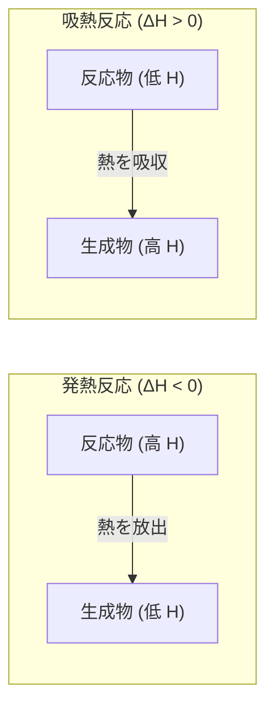
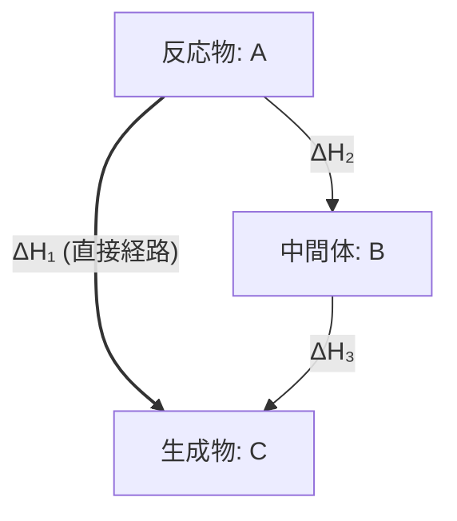

---
aliases:
  - 反応熱とエンタルピー
  - 反応熱
  - 反応エンタルピー
  - enthalpy of reaction
date: 2026-11-21
tags:
  - 化学
  - 物理化学
  - 熱力学
related:
  - "[[thermodynamics/エンタルピー|エンタルピー]]"
  - "[[ルシャトリエの原理]]"
---

# 反応熱とエンタルピー

化学反応に伴って系と外界の間で出入りする熱エネルギー（**反応熱**）と、熱力学状態量である**[[エンタルピー]]**の関係について解説する。

日常および実験室の環境は大気圧下（**定圧条件**）にあるため、反応熱は**エンタルピー変化（$\Delta H$）**として定量的に記述される。

---

## 1. 反応熱とエンタルピー変化の符号関係

定圧過程における熱力学第1法則より、外界から系に流入する熱量 $Q_p$ はエンタルピー変化 $\Delta H$ と等しい。化学反応における「反応熱 $Q$」は伝統的に**系から外界へ放出される熱量**を正と定義するため、両者の符号は**正負が逆**になる。

$$Q = -\Delta H \quad \Longleftrightarrow \quad \Delta H = -Q$$

| 区分 | 反応熱 $Q$（外界視点） | エンタルピー変化 $\Delta H$（系視点） | エネルギー変化の直観 |
| :--- | :--- | :--- | :--- |
| **発熱反応**（Exothermic） | $Q > 0$（熱を放出） | **$\Delta H < 0$** | 系の保有エネルギーが減少し、より安定な状態へ移行する。 |
| **吸熱反応**（Endothermic） | $Q < 0$（熱を吸収） | **$\Delta H > 0$** | 系の保有エネルギーが増加し、より高いエネルギー状態へ移行する。 |

---

## 2. 表記法の変遷（熱化学方程式からエンタルピー変化表記へ）

かつて日本の高等学校化学等で用いられていた「熱化学方程式」と、国際標準（IUPAC勧告）および現在の標準課程である「エンタルピー変化表記」には以下の対応関係がある。

### 例：炭素（黒鉛）の完全燃焼

* **エンタルピー変化表記（国際標準・現行）**:
  $$\mathrm{C(graphite) + O_2(g) \rightarrow CO_2(g)} \quad \Delta H = -394\,\mathrm{kJ/mol}$$
  通常の化学反応式の右側に、状態変化量 $\Delta H$ を付記する。

* **熱化学方程式（旧表記）**:
  $$\mathrm{C(黒鉛) + O_2(気) = CO_2(気) + 394\,kJ}$$
  化学物質と熱量を等号（$=$）で結び、発熱を正の項として右辺に置く。

### 表記移行の学術的理由
1. **数学的誤解の防止**:
   熱化学方程式の等号結びは物質とエネルギーを同一視するような混同を招きやすい。
2. **熱力学体系との整合性**:
   ギブズ自由エネルギー変化（$\Delta G = \Delta H - T\Delta S$）やエントロピー変化（$\Delta S$）と形式を統一できる。
3. **系の視点への統一**:
   物理学・国際化学標準（IUPAC）において、「系のエネルギーが増える変化を正（$+$）、減る変化を負（$-$）」とする規約に統一されている。

---

## 3. ヘスの法則（総熱量保存の法則）

**ヘスの法則（Hess's law）**は、「化学反応に伴うエンタルピー変化（反応熱）は、反応の初状態（反応物）と終状態（生成物）のみによって定まり、途中の反応経路には依存しない」という法則。

これは、**エンタルピー $H$ が状態量（経路に依存しない熱力学関数）であることの直接の帰結**である。

$$\Delta H_1 = \Delta H_2 + \Delta H_3$$

直接測定が困難な反応（例: $\mathrm{C} \rightarrow \mathrm{CO}$ の不完全燃焼熱など）であっても、他の既知の反応エンタルピーを組み合わせることで算出できる。

---

## 4. 主な反応エンタルピーの種類

化学反応の種類に応じて、基準となるモル量あたりのエンタルピー変化が定義されている。

### ① 標準生成エンタルピー（$\Delta_f H^\circ$）
* **定義**: 標準状態（$25\,^\circ\mathrm{C}, 1\,\mathrm{bar}$）において、化合物を構成する**最も安定な成分単体から化合物 $1\,\mathrm{mol}$ が生成するときのエンタルピー変化**。
* **規約**: 最も安定な同素体・単体の標準生成エンタルピーは **$0$** と定める（例: $\Delta_f H^\circ(\mathrm{O_2(g)}) = 0$, $\Delta_f H^\circ(\mathrm{C(graphite)}) = 0$）。
* **反応エンタルピーの一般計算法**:
  $$\Delta_r H^\circ = \sum \nu \, \Delta_f H^\circ (\text{生成物}) - \sum \nu \, \Delta_f H^\circ (\text{反応物})$$
  （※ $\nu$ は化学量論係数）

### ② 燃焼エンタルピー（$\Delta_c H^\circ$）
* 物質 $1\,\mathrm{mol}$ が完全燃焼する際のエンタルピー変化。燃焼はすべて発熱反応であるため、**常に $\Delta_c H^\circ < 0$**。

### ③ 中和エンタルピー（$\Delta_{\mathrm{neut}} H^\circ$）
* 酸と塩基が中和して水 $1\,\mathrm{mol}$ が生成するときのエンタルピー変化。
* 強酸と強塩基の希薄水溶液間の中和反応は実質的に $\mathrm{H^+(aq) + OH^-(aq) \rightarrow H_2O(l)}$ のみであるため、酸・塩基の種類によらずほぼ一定（$\Delta H \approx -56.5\,\mathrm{kJ/mol}$）となる。

### ④ 結合エンタルピー（結合解離エネルギー）
* 気体状態の分子内の共有結合 $1\,\mathrm{mol}$ を切断して、気体状態の原子に解離するのに必要なエンタルピー（結合切断は常に吸熱 $\Delta H > 0$）。

---

## 5. 定圧反応熱 $Q_p$ と定容反応熱 $Q_v$ の相違

実験手法によって測定される熱量が異なる。

* **定圧反応熱（$Q_p$）**: 開放容器や一般的なフロー反応器で測定 $\rightarrow$ **$\Delta H$（エンタルピー変化）**
* **定容反応熱（$Q_v$）**: 密閉容器（ボンブ熱量計など）で測定 $\rightarrow$ **$\Delta U$（内部エネルギー変化）**

気体が関与する反応では、体積変化に伴う膨張仕事 $p\Delta V$ の分だけ両者に差が生じる。

$$\Delta H = \Delta U + \Delta (pV) \approx \Delta U + \Delta n_g RT$$

* $\Delta n_g$: 反応に伴う気体成分のモル数変化（$\text{生成気体のモル数} - \text{反応気体のモル数}$）
* 気体分子数の変化を伴わない反応（$\Delta n_g = 0$）や、液体・固体のみの反応では $\Delta H \approx \Delta U$ となる。
