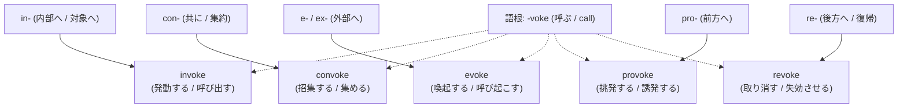

---
aliases:
  - 語根 -voke
  - "*voke"
  - voke
date: 2026-11-21
tags:
  - 英語
  - 英語/語源
  - 英語/語彙
---

# 語根 voke を持つ英単語の分類と語源解説

英語の `-voke` で終わる動詞群は、いずれもラテン語の **`vocare`（呼ぶ／声を出す）** および **`vox`（声）** に由来します。

共通する語義核（コア）は **「呼ぶ（call）」** であり、付加される接頭辞（方向・様態）によって意味が分化しています。

---

## 1. 接頭辞と派生動詞の構造

---

## 2. 主要動詞の解説と用例

### invoke
* **語源構成**: `in-`（内部へ／対象へ） + `voke`（呼ぶ）
* **原義**: 対象に向かって助けや権威を呼び寄せる
* **語義**:
  1. （法・権利・権威・条項を）**発動する、根拠として挙げる**
  2. （神仏や加護を）**祈願する**
  3. 【計算機科学】（ルーチンやAPIを）**呼び出す、実行する**
* **主要用例**:
  * `invoke Article 5`: （条約の）第5条を発動する
  * `invoke the right to remain silent`: 黙秘権を行使する
  * `invoke a procedure / method`: 手続き／メソッドを呼び出す

---

### convoke
* **語源構成**: `con-`（共に／一堂に） + `voke`（呼ぶ）
* **原義**: 人々を一箇所に呼び集める
* **語義**:
  1. （公的な会議・議会・構成員を）**招集する**（類語: `convene`, `summon`）
* **主要用例**:
  * `convoke parliament`: 議会を招集する
  * `convoke a council`: 評議会を招集する

---

### evoke
* **語源構成**: `e-`（`ex-` の異形：外部へ） + `voke`（呼ぶ）
* **原義**: 内奥にあるものを外へ呼び出す
* **語義**:
  1. （記憶・感情・印象を）**呼び起こす、喚起する**
  2. （反応や連想を）**誘い出す**
* **主要用例**:
  * `evoke memories`: 記憶を呼び起こす
  * `evoke nostalgia`: 郷愁を誘う
  * `evoke a response`: 反応を引き出す

---

### provoke
* **語源構成**: `pro-`（前方へ） + `voke`（呼ぶ）
* **原義**: 前へ出てくるよう呼び立てる
* **語義**:
  1. （人を）**挑発する、怒らせる**
  2. （事態・感情・抗議などを）**引き起こす、誘発する**
* **主要用例**:
  * `provoke a reaction`: 反応を誘発する
  * `provoke hostilites`: 敵対行動を引き起こす
  * `provoke debate`: 議論を巻き起こす

---

### revoke
* **語源構成**: `re-`（後方へ／元へ） + `voke`（呼ぶ）
* **原義**: 一度与えた言質や権限を手元へ呼び戻す
* **語義**:
  1. （法令・命令・許可・免許などを）**取り消す、撤回する、無効にする**
* **主要用例**:
  * `revoke a license`: 免許を取り消す
  * `revoke access privileges`: アクセス権限を剥奪する
  * `revoke an offer`: 申し出を撤回する

---

## 3. 派生語（名詞形・形容詞形）の対応

`-voke` 型の動詞は、名詞化・形容詞化において以下のような形態的規則性を示します。

| 動詞 (`-voke`) | 名詞形 (`-vocation`) | 形容詞形 (`-vocative` / `-vocable`) | 備考 |
| :--- | :--- | :--- | :--- |
| **invoke** | **invocation** （発動、祈念、関数の呼び出し） | **invocatory** （祈願の、呼び出しの） | 名詞形はプログラミング言語・APIの仕様書で定着。 |
| **convoke** | **convocation** （招集、集会、学位授与式） | — | 欧米の高等教育機関における公式式典を指すことが多い。 |
| **evoke** | **evocation** （喚起、再現） | **evocative** （想起させる、喚起的な） | 形容詞形（`an evocative description` 等）の頻度が高い。 |
| **provoke** | **provocation** （挑発、誘因） | **provocative** （挑発的な、刺激的な） | 形容詞形は言動や視覚的表現に対しても多用される。 |
| **revoke** | **revocation** （取消、撤回、失効） | **irrevocable** （取り消し不能の、最終的な） | 否定接頭辞 `in-` が付いた `irrevocable`（決定・判決等）が頻出。 |

---

## 4. 分野別の主な用法

### 法律・行政・国際関係
* **`invoke`**: 憲法条項、権利、特権の適用・発動
* **`revoke`**: 許可証、ビザ、条約、特許の失効・取り消し
* **`convoke`**: 議会、特別総会、国際会議の招集

### 計算機科学・ソフトウェア
* **`invoke`**: 手続き、メソッド、関数、サブルーチンの呼び出し
  * 例: メソッドインボケーション（Method Invocation）、リモートプロシージャ呼び出し
* **`revoke`**: トークン、認証情報、証明書の無効化
  * 例: 証明書失効リスト（Certificate Revocation List: CRL）、OAuthトークン失効

### 心理・修辞学
* **`evoke`**: 内的記憶、情緒、情景の喚起
* **`provoke`**: 心理的反発、感情的摩擦の誘発

---

## 5. 同根語（語根 `voc- / vok-`）

`-voke` 以外の語尾をとる関連語句：

* **vocation** (`vocare` ＋ 名詞接尾辞 `-tion`): 召命（神からの呼び声） $\rightarrow$ **天職、職業**
* **avocation** (`a-` [分離] ＋ `vocation`): 本業から離れた活動 $\rightarrow$ **副業、趣味**
* **advocate** (`ad-` [〜に向かって] ＋ `vocare`): 声を大にして主張する者／こと $\rightarrow$ **擁護者、提唱する**
* **equivocal** (`equi-` [等しい] ＋ `voc-` ＋ 形容詞接尾辞): 同じ重みの複数の声に聞こえる $\rightarrow$ **多義の、曖昧な**
* **vocal**: 声の、声高に主張する
