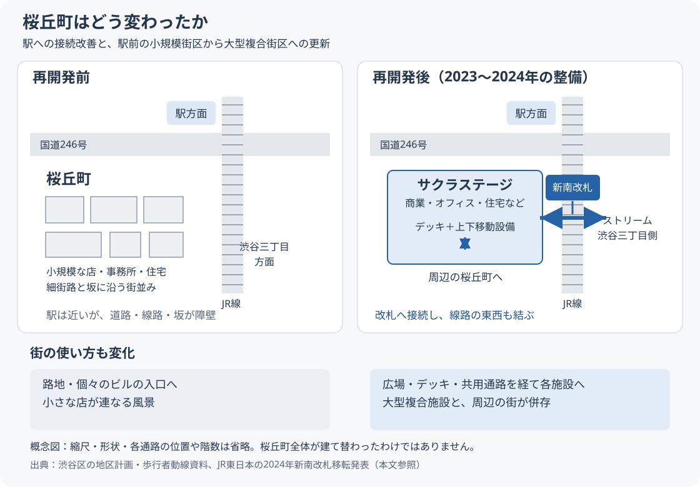

---
aliases:
  - 桜丘町の再開発前後
tags:
  - 地理
  - 東京
  - 都市計画
  - 渋谷
date: 2026-10-30
---

# 渋谷駅再開発で桜丘町はどう変わったか

桜丘町の変化は、**駅に近いのに線路・幹線道路・坂で行き来しにくかった街に、新しい改札と立体的な歩行者通路ができ、駅前の小規模な建物群が大型複合施設へ置き換わったこと**にある。歩きやすさと都市機能が増す一方、従来の店や路地の風景も変わった。

ここで中心に扱うのは、[[渋谷駅再開発]]のうち**渋谷駅桜丘口地区第一種市街地再開発事業＝渋谷サクラステージ**と、JR渋谷駅の新南改札・周辺通路の整備。事業区域は約2.6haであり、**桜丘町全体を一度に建て替えたわけではない**。[東京都：市街地再開発事業一覧](https://www.toshiseibi.metro.tokyo.lg.jp/machizukuri/shigaichi_seibi/sai-kai/saikaihatsu)、[渋谷区：桜丘口地区再開発](https://www.city.shibuya.tokyo.jp/kankyo/toshikeikaku/toshikeikaku-jigyo/shigaichi_saikai_04.html)

## 再開発前後の比較

道路・線路による分断と、新しい改札・通路による接続を示す概念図。正確な地図や道案内ではなく、各通路の位置・階数は省略している。青は新しい接続や複合施設を表す。図の根拠は下記の渋谷区・JR東日本の資料。

| 観点 | 再開発前 | 再開発後 |
| --- | --- | --- |
| 駅との関係 | 駅に隣接していても、国道246号やJR線が移動の障壁 | サクラステージから新南改札へ接続し、山手線・埼京線の両ホームへアクセス |
| 東西の移動 | 桜丘側と渋谷三丁目側の間で線路を越えにくい | 線路上空の通路でストリーム側・ホテルメッツ側へ接続 |
| 坂・高低差 | 坂や階段による上下移動の負担 | デッキとエレベーターなどで地上・上階を結び、段差を迂回する選択肢が増える |
| 建物・街区 | 小規模な敷地・建物と細街路が集積 | 敷地を共同化し、大型複合施設・道路・広場を一体整備 |
| 商業 | 個人経営の飲食店などが既存ビルや路地に立地 | 大型施設内の商業・飲食空間が加わり、店舗構成と店への入り方が変化 |
| 働く・住む | 小規模な事務所、店舗、住宅などが混在 | 大規模オフィス、住宅、サービスアパートメント、医療などを集約 |
| 防災 | 老朽建物や狭い道路などが課題 | 建物更新・道路拡幅に加え、災害時の支援に使う空間を計画 |

比較の根拠：[渋谷区：2014年の地区計画説明資料](https://files.city.shibuya.tokyo.jp/assets/12995aba8b194961be709ba879857f70/d47bcea646a94b95829c5a969b1422c5/assets_detail_files_kurashi_machi_pdf_sakuragaoka20141020_03a.pdf)、[JR東日本：新南改札の移転発表](https://www.jreast.co.jp/press/2024/tokyo/20240423_to03.pdf)、[日建設計：Shibuya Sakura Stage](https://www.nikken.co.jp/ja/projects/shibuya_sakura_stage_redevelopment_project.html)。

## 1. 「駅に近いが回り道する街」から、駅につながる街へ

桜丘町は渋谷駅の南西にある。しかし北側には国道246号、東側にはJR線があり、駅や渋谷三丁目方面へ直線的に歩きにくかった。谷から丘へ上がる高低差もある。駅からの距離だけでは、実際の行きやすさを説明できない場所だった。[渋谷区：地区計画説明資料](https://files.city.shibuya.tokyo.jp/assets/12995aba8b194961be709ba879857f70/d47bcea646a94b95829c5a969b1422c5/assets_detail_files_kurashi_machi_pdf_sakuragaoka20141020_03a.pdf)

再開発では、建物と周辺道路をつなぐデッキや、階をつなぐエレベーター・エスカレーターなどの「アーバン・コア」を整備した。さらに2024年7月21日、**JR新南改札が線路上空の新駅舎へ移転**。サクラステージと渋谷ストリームの間の通路に接続し、山手線・埼京線の両ホームへ直接アクセスできるようになった。[日建設計：設計の解説](https://www.nikken.co.jp/ja/projects/shibuya_sakura_stage_redevelopment_project.html)、[JR東日本：新南改札の移転発表](https://www.jreast.co.jp/press/2024/tokyo/20240423_to03.pdf)

このため、桜丘町から駅へ向かう経路に加え、**桜丘町―駅―ストリーム・渋谷三丁目を行き来する経路**ができた。建物の上階が、単に店舗やオフィスへ上がる場所ではなく、街から街へ抜ける歩行空間にもなっている。[渋谷区：歩行者動線の説明資料](https://files.city.shibuya.tokyo.jp/assets/12995aba8b194961be709ba879857f70/eee031c9d9ab4870933619d36a5c265c/dai2kai_setsumeikaisiryo.pdf)

ただし、坂そのものがなくなったわけではない。通路には階数や利用時間の違いもあるため、**歩行経路の選択肢が増えた**と捉えるのが適切である。

## 2. 小さな建物が連なる駅前から、大きな複合街区へ

再開発前の地区は、飲食店・事務所・住宅などの多様な用途が、小規模な敷地と建物に分かれて立地していた。再開発では敷地をまとめ、オフィス、商業、住宅、サービスアパートメントなどを持つサクラステージへ更新した。道路整備も併せて行い、区域内の補助線街路第18号線は2023年12月1日に開通した。[渋谷区：事業計画書](https://files.city.shibuya.tokyo.jp/assets/12995aba8b194961be709ba879857f70/3c8a2570264847a9b824f9b409d46d51/shigaichi_saikai_04_jigyoukeikakusyo_sakura6.pdf)、[渋谷区：補助線街路第18号線](https://www.city.shibuya.tokyo.jp/kankyo/toshikeikaku/keikaku-doro/douro_hojo18.html)

変わったのは建物の高さだけではない。**通りに面した個々のビルへ入る構成から、複合施設の広場・デッキ・共用通路を通って目的地へ向かう構成へ**、街の使い方も変わった。これは事業計画と設計から読み取れる変化である。

## 3. 店の入れ替わりと、以前の桜丘の風景

再開発前の桜丘には、小さな飲食店や音楽に関わる店などが集まっていた。2018年秋には、再開発に伴って営業を終える店が相次いだ。たとえば旧来の大衆立呑酒場「富士屋本店」は2018年10月30日に閉店し、ジャズ喫茶「メアリージェーン」なども当時の場所での営業を終えたと報じられている。[ダイヤモンド・オンライン：2018年の閉店取材](https://diamond.jp/articles/-/183924)、[渋谷文化プロジェクト：2018年の振り返り](https://www.shibuyabunka.com/blog.php?id=1035)

したがって、**新しい商業施設ができたことと、以前の商店街の店・客・雰囲気がそのまま引き継がれたことは分けて考える必要がある**。同じ店名が別の場所で再開する場合もあり、当時の閉店記事だけで店そのものが永久になくなったとは判断できない。

大型施設の飲食や買い物の選択肢は増えた。一方、古いビルの地下、路地沿いの小さな入口、常連客の集まる店などが作っていた風景は、建物の解体とともに変化した。利便性の改善と、以前の場所の記憶をどう残すかは、別々に評価する論点となる。

## 4. 買い物客だけでなく、働く人・住む人の拠点へ

サクラステージには大規模なオフィスと住宅・滞在機能が入り、通勤、買い物、食事、居住、医療などの目的が一つの地区に重なる。事業者は2025年7月時点で、同施設で働く人を約1万人と発表している。これは事業者発表の施設内の人数であり、桜丘町の住民人口を示す数字ではない。[東急不動産：開業1年間の取り組み（2025年7月11日）](https://www.tokyu-land.co.jp/news/uploads/966471e586450591402923f426e8fc5e63295674.pdf)

こうした機能の集積は、平日の昼食や仕事帰りなど、街を使う時間帯や需要を変える要因になる。ただし、周辺の全店舗の売上増や、桜丘町全体の賃料上昇を、この資料だけで確定することはできない。

## 主な時系列

| 時期 | 出来事 |
| --- | --- |
| 2014年 | 桜丘口地区再開発の都市計画決定 |
| 2018年秋 | 再開発区域の既存店が閉店・移転する時期 |
| 2023年11月30日 | サクラステージ竣工。以降、順次開業 |
| 2023年12月1日 | 南通路や区域内の補助線街路第18号線などが供用開始 |
| 2024年7月21日 | 新駅舎へ移転したJR新南改札が使用開始 |
| 2024年7月 | 商業機能などがそろい、まちびらき |

出典：[渋谷区：再開発事業](https://www.city.shibuya.tokyo.jp/kankyo/toshikeikaku/toshikeikaku-jigyo/shigaichi_saikai_04.html)、[東急不動産：事業概要](https://www.tokyu-land.co.jp/mxd/shibuyasakurastage/)、上記のJR東日本・渋谷区の交通資料。

## 桜丘町全体の再開発が終わったわけではない

サクラステージの完成と、桜丘町全体のまちづくりは同じ範囲ではない。2026年10月の渋谷区都市計画審議会の付議予定案件にも「桜丘地区都市計画（素案）」が掲載されている。**完成した施設、供用済みの通路、今後の計画を区別して見る**必要がある。[渋谷区：都市計画審議会](https://www.city.shibuya.tokyo.jp/kankyo/toshikeikaku/keikaku-info/shingikai.html)

確認日：2026年10月30日。交通動線の解説は供用開始時の公式資料を中心に整理したもので、当日の工事規制・通行時間は現地案内も確認する。

関連：[[渋谷駅再開発]]、[[渋谷駅]]
