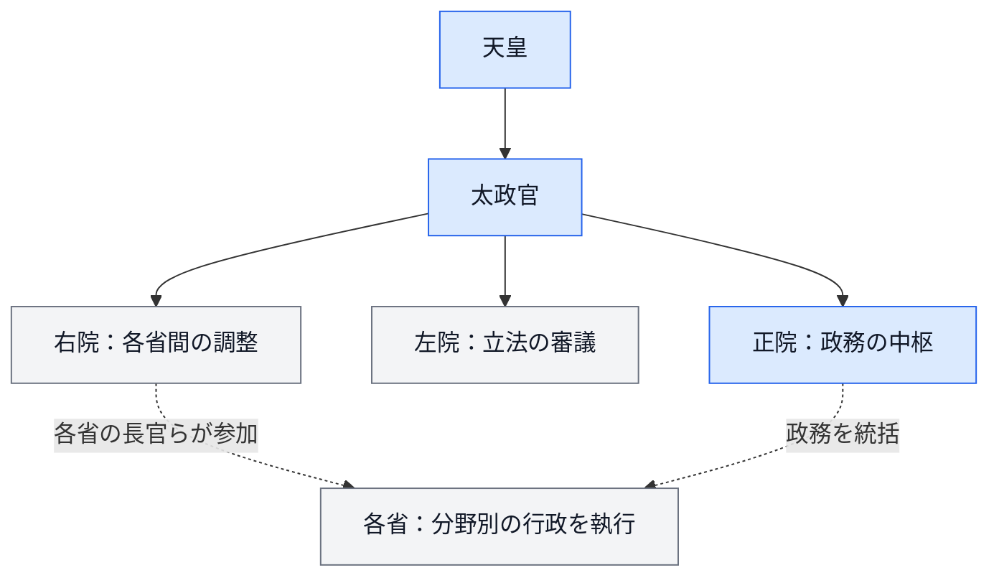
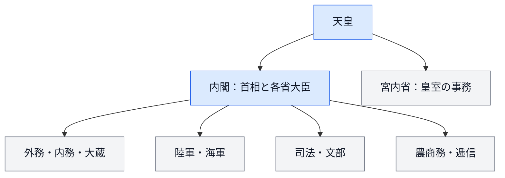

---
aliases:
  - 明治政府の統治機構
  - 明治政府の中央官制
  - 太政官制から内閣制度へ
時代:
  - 明治時代
tags:
  - 日本史
  - 政治
  - 行政
---

# 明治政府の行政機構

明治政府の行政機構は、**太政官を中心とする体制から、内閣総理大臣と各省大臣で構成する内閣制度へ**と変化した。地方では藩を廃して府県を政府の下に置き、中央では仕事の分野ごとに省を整えていった。

明治時代を通じて同じ組織図だったわけではない。以下では、中央行政の変遷を中心に、地方行政、立法・司法、宮中・軍との関係を整理する。[国立国会図書館：太政官制](https://www.ndl.go.jp/modern/cha1/description04.html)、[同：内閣制度成立](https://www.ndl.go.jp/modern/cha2/description06.html)

## 変遷の一覧

| 時期 | 中央機構の骨格 | 変化の意味 |
| --- | --- | --- |
| 1868年初め | 総裁・議定・参与の[[三職]] | 新政府の首脳による政治運営を組織化。 |
| 1868年・政体書 | [[太政官制]]、七官 | 立法・行政・司法の分担を掲げた政府機構を構想。 |
| 1869年・職員令 | 二官六省 | 神祇官・太政官と、分野別の省を整備。 |
| 1871年・廃藩置県後 | 太政官の三院制 | 正院・左院・右院を置き、政務決定・立法審議・各省間の調整を分担。 |
| 1873年 | 内務省設置 | 地方行政や内政の統括を強化。 |
| 1875年 | 左院・右院廃止、元老院・大審院設置 | 立法審議と司法の機構を再編。 |
| 1885年12月22日 | [[内閣制度]]創設 | 太政官制を廃し、首相と各省大臣で内閣を構成。 |
| 1888〜1890年 | 枢密院、帝国憲法、帝国議会 | 内閣に加え、天皇の諮問機関や議会などを備えた立憲体制へ。 |

太政官制の変遷は[国会図書館の年表](https://www.ndl.go.jp/modern/utility/chronology.html)と[アジア歴史資料センターの解説](https://www.jacar.go.jp/exhibition/glossary/term3/0010-0010-0020.html)、内閣制度創設は[国立公文書館の解説](https://www.archives.go.jp/ayumi/kobetsu/m18_1885_01.html)を参照。

明治初期の月日は旧暦で記された資料がある。このページの初期の年表は年を中心に示し、旧暦の月日をそのまま現在の暦の日付として扱わない。

## 1. 三職と政体書――新政府の組織を作る

### 総裁・議定・参与

新政府発足時には、総裁・議定・参与の三職を置いた。大まかには、政府全体を率いる総裁、重要事項を議する議定、その議論・執行に関わる参与という構成だった。公家や有力諸藩の人物が参加し、既存の幕府機構に代わる首脳体制を作った。[国会図書館：太政官制](https://www.ndl.go.jp/modern/cha1/description04.html)

三職は省庁の名前ではなく、政府中枢の役職区分である。「総裁＝現在の首相」と完全に対応させることはできない。

### 1868年の政体書

[[政体書]]は、政府の権力を太政官に集めつつ、立法・行政・司法を分担する方針を掲げた。議政官、行政官、神祇官、会計官、軍務官、外国官、刑法官の七官を置く構成である。[国会図書館：太政官制](https://www.ndl.go.jp/modern/cha1/description04.html)、[「行政」という概念と政体書の研究](https://meigaku.repo.nii.ac.jp/record/621/files/hougaku_92_19-90.pdf)

| 分担 | 主な機関 | 大まかな役割 |
| --- | --- | --- |
| 立法 | 議政官 | 政治上の議論・立法に関する審議。 |
| 行政 | 行政官と、神祇・会計・軍務・外国の各官 | 政務の統括と分野別の執行。 |
| 司法 | 刑法官 | 刑罰・裁判に関する事務。 |

近代的な権力分立の考えを取り入れたが、民選議会が政府を統制する仕組みではない。七官は現在の国会・内閣・裁判所がそのまま成立したものとも異なる。

## 2. 1869年の二官六省

職員令によって、**神祇官と太政官の二官**、および太政官の下の六省を置いた。名称には律令制の影響があるが、明治国家を運営するための再編である。[国会図書館：行政機構改革の歴史](https://dl.ndl.go.jp/view/download/digidepo_9497212_po_077603.pdf?contentNo=1)

| 機関 | 主な担当分野 |
| --- | --- |
| 神祇官 | 祭祀など。太政官とは別に置かれた。 |
| 太政官 | 政務の統括。 |
| 民部省 | 戸籍・土地・地方の民政など。 |
| 大蔵省 | 財政・会計など。 |
| 兵部省 | 陸海軍に関する事務。 |
| 刑部省 | 司法・刑罰に関する事務。 |
| 宮内省 | 宮中・皇室に関する事務。 |
| 外務省 | 外交に関する事務。 |

所管は固定されず、民部省と大蔵省の統合・分離などもあった。**「二官六省」は1869年の一段階の説明であり、明治初期全体の固定的な組織名ではない。**

## 3. 1871年の太政官三院制

廃藩置県後の官制改革で、太政官を正院・左院・右院に分けた。各省の事務が増える中、政府の意思決定と部門別の行政を調整する仕組みだった。[アジ歴：太政官](https://www.jacar.go.jp/exhibition/glossary/term3/0010-0010-0020.html)

図は三院の役割を示す模式図。右院を、現在の内閣のように各省を一元的に指揮する独立機関として描いたものではない。

| 院 | 役割 | 注意点 |
| --- | --- | --- |
| 正院 | 太政大臣・左右大臣・参議らによる政務の中枢。 | 後の首相と閣僚の仕組みとは役職・責任の構成が異なる。 |
| 左院 | 立法に関する審議。 | 民選の国会ではない。 |
| 右院 | 各省長官らによる行政上の協議・調整。 | 定例開催の廃止などにより、当初の形のまま続かなかった。 |

三院制も変化し、1875年に左右両院を廃止して元老院・大審院を設け、1877年には正院も廃止した。したがって、「太政官制＝常に三院制」ではない。[アジ歴：三院制以後の改編](https://www.jacar.go.jp/exhibition/glossary/term3/0010-0010-0020.html)

## 4. 内務省と各省の整備

政府は殖産興業、教育、徴兵、徴税、警察などの仕事を分野別に組織化した。省の新設・分割・廃止に伴い、同じ仕事が別の省へ移ることも多かった。

| 主な改編 | 行政機構上の意味 |
| --- | --- |
| 工部省の設置（1870年） | 工業・鉄道など近代化事業の担当機構を整備。 |
| 文部省・司法省の設置（1871年） | 教育と司法行政を担当する省を整備。 |
| 兵部省を陸軍省・海軍省へ分割（1872年） | 陸海軍それぞれの軍事行政を組織化。 |
| 内務省の設置（1873年） | 地方行政・警察などを含む内政の統括を強化。 |
| 農商務省の設置（1881年） | 農業・商工業などの行政を再編。 |
| 工部省廃止・逓信省設置（1885年） | 産業行政を再編し、通信・交通関係の担当を整備。 |

改編の流れは[国会図書館の行政機構史](https://dl.ndl.go.jp/view/download/digidepo_9497212_po_077603.pdf?contentNo=1)、当時の機関構成は[官員録の案内](https://ndlsearch.ndl.go.jp/rnavi/politics/public_officer/kaninroku_meiji2gov)を参照。

### 内務省は何をしたか

1873年、大久保利通の主導で内務省を設置した。地方行政・警察に加えて、時期によって勧業、土木、衛生、社寺なども担当した。農商務省などへの事務移管を経て、地方・警察行政が中心となった。[アジ歴：内務省関係](https://www.jacar.archives.go.jp/das/meta/AA0700000000)、[同：内務大臣](https://www.jacar.go.jp/english/exhibition/glossary_en/term1/0090-0010-0040-0020-0010.html)

現代の一つの省にそのまま対応させにくい。府県への監督と警察を握ることで、中央の政策を全国で実行するうえで大きな役割を持った。

## 5. 地方行政――藩を残す体制から中央集権へ

| 段階 | 地方の仕組み | 中央との関係 |
| --- | --- | --- |
| 府藩県三治制（1868年） | 府・藩・県が並立。 | 藩による支配が残り、中央の直轄地域と併存。 |
| 版籍奉還（1869年） | 旧藩主を知藩事に任命。 | 土地・人民を朝廷に返す建前を整えたが、旧藩主の地方支配はなお残った。 |
| [[廃藩置県]]（1871年） | 藩を廃止して府県へ。 | 中央政府が地方長官を任命・派遣する体制へ。 |
| 内務省設置後 | 府県行政を中央から監督。 | 内務省と地方長官を通じて中央の方針を実行。 |

**版籍奉還では藩が残り、廃藩置県で藩という行政単位を廃した**ことが重要。地方議会・自治制度はその後も整備されるが、府県は中央政府による行政執行の経路でもあった。[国立公文書館：版籍奉還と廃藩置県](https://www.archives.go.jp/exhibition/digital/modean_state/contents/return/index.html)、[全国都道府県議会議長会：府県会前史](https://www.gichokai.gr.jp/b10b.asp?SrchID=1&kword1=)

## 6. 1885年の内閣制度

1885年12月22日、太政官制に代わり、**内閣総理大臣と各省大臣による内閣**が成立した。初代首相は伊藤博文。各省の長官の呼称も「卿」から「大臣」へ改められた。[国立公文書館：内閣制度創設](https://www.archives.go.jp/ayumi/kobetsu/m18_1885_01.html)、[国会図書館：内閣制度成立](https://www.ndl.go.jp/modern/cha2/description06.html)

図は1885年発足時の基本的な区分。各省内の局や、軍令機関などは省略している。**宮内大臣は内閣の構成員から除かれた**。同じ人物が首相と宮内大臣を兼ねることと、宮内省を内閣の一省として扱うことは別である。

### 太政官制から何が変わったか

| 観点 | 太政官制 | 内閣制度 |
| --- | --- | --- |
| 中枢 | 太政大臣・左右大臣・参議など。 | 内閣総理大臣と各省大臣。 |
| 政策決定と執行 | 中枢の議政と各省の執行の関係を、改編・兼任などで調整。 | 各省の責任者が内閣の構成員となる。 |
| 統括 | 太政官の中枢を通じて政務を処理。 | 首相が各大臣・各省との調整を担う。 |
| 宮中との関係 | 太政官の下で宮内省を置いた時期がある。 | 宮内大臣を内閣の構成員から分離。 |

1885年の「内閣職権」は首相に強い統督権を認めたが、1889年の内閣官制では、帝国憲法の国務各大臣による輔弼の仕組みに合わせて調整された。首相の権限も、発足時から一定ではない。[国会図書館：内閣職権と内閣官制](https://www.ndl.go.jp/modern/cha2/description06.html)

## 7. 内閣の外にある機関との関係

内閣制度ができても、国政に関わるすべての組織が首相の下へ一本化されたわけではない。

| 機関・領域 | 主な役割・内閣との違い |
| --- | --- |
| [[枢密院]]（1888年） | 天皇の諮問に応じて重要事項を審議。内閣や帝国議会そのものではない。 |
| 帝国議会（1890年開設） | 貴族院・衆議院による法律・予算などの審議。行政の執行機関ではない。 |
| 裁判所 | 裁判を行う。司法省の司法行政と、個別の事件を裁く働きは区別する。 |
| 宮内省 | 皇室・宮中の事務。内閣の構成から分離。 |
| 参謀本部などの軍令機関 | 軍の作戦・兵力運用。軍事行政を担当する陸軍省・海軍省とは区別。 |

枢密院と帝国議会の設置時期・役割は、[アジ歴：枢密院関係文書](https://www.jacar.archives.go.jp/das/meta/AA0500000000)と[国立公文書館：第1回帝国議会](https://www.archives.go.jp/ayumi/kobetsu/m23_1890_03.html)を参照。

特に陸軍では、1878年に参謀本部が天皇直属の軍令機関として独立した。**軍政は人事・予算などの軍事行政、軍令は作戦・兵力運用**を中心とする。陸軍省があるから軍の指揮命令すべてが内閣を通る、と考えるのは正確ではない。[アジ歴：陸軍の制度](https://www.jacar.go.jp/exhibition/nichibei/reference/index16.html)

[[大日本帝国憲法]]では国務各大臣が天皇を輔弼して責任を負う仕組みとされ、現行憲法のように、内閣が国会に対して連帯責任を負う制度とは異なった。もっとも、実際の政治では議会との協力や政党の影響も強まっていく。[アジ歴：内閣総理大臣](https://www.jacar.go.jp/exhibition/glossary/term1/0090-0010-0040-0010-0010.html)

## 理解のための要点

- **太政官制は一つの固定した制度ではない。** 政体書、職員令、三院制などを経て改編された。
- **中央の制度変更と地方の中央集権化を合わせて見る。** 省を作るだけでなく、府県を通じて政策を実行する仕組みが必要だった。
- **内閣制度は帝国憲法より先にできた。** 内閣1885年、憲法公布1889年、施行・帝国議会開設1890年の順。
- **「省」と「裁判所」、「軍政」と「軍令」を区別する。** 同じ分野の組織でも役割と系統が違う。
- **藩閥は官庁名ではない。** 制度上の役職・機関と、薩摩・長州出身者などの政治的な人脈・影響力は別の層として考える。

## 参考資料

- [国立国会図書館：太政官制](https://www.ndl.go.jp/modern/cha1/description04.html)
- [国立国会図書館：内閣制度成立](https://www.ndl.go.jp/modern/cha2/description06.html)
- [国立国会図書館：日本の行政機構改革](https://dl.ndl.go.jp/view/download/digidepo_9497212_po_077603.pdf?contentNo=1)
- [国立公文書館：内閣制度創設](https://www.archives.go.jp/ayumi/kobetsu/m18_1885_01.html)
- [国立公文書館：版籍奉還と廃藩置県](https://www.archives.go.jp/exhibition/digital/modean_state/contents/return/index.html)

関連：[[太政官（明治）]]、[[太政官制]]、[[政体書]]、[[内閣制度]]、[[廃藩置県]]、[[大日本帝国憲法]]、[[枢密院]]
