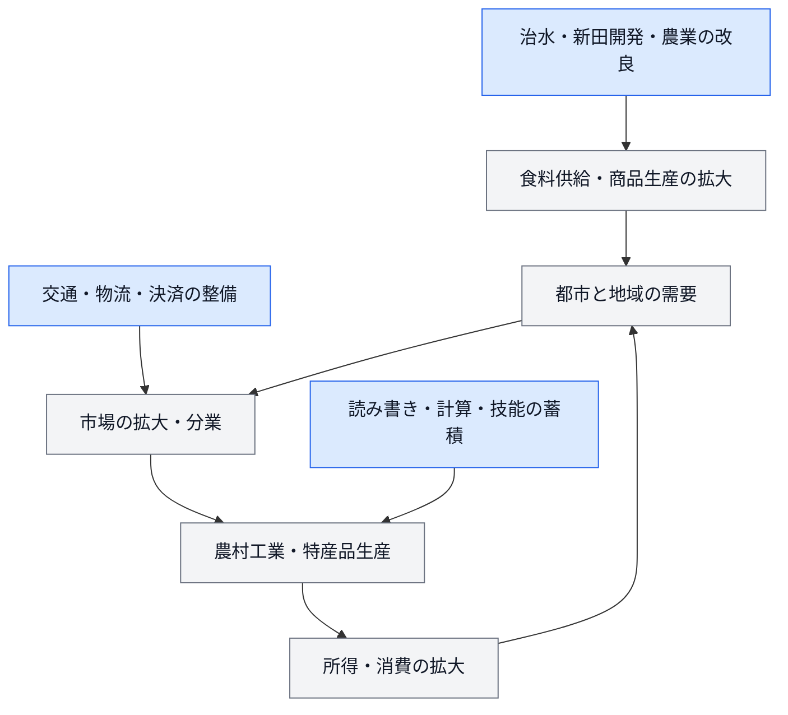

---
aliases:
  - 江戸時代の経済成長
  - 近世日本の経済発展
  - 徳川日本の経済成長
時代:
  - 江戸時代
tags:
  - 日本史
  - 経済史
  - 人口
---

# 江戸時代の日本の成長

**江戸時代の日本では、前期に人口と耕地が大きく増え、中後期には人口増加が鈍る一方で、農業の集約化、農村の商工業、流通・金融が発達した。** 明治維新で突然経済活動が始まったのではなく、近代化を支える生産・取引・技能の基盤が近世に蓄積された。

ただし、成長は時期・地域・階層によって異なる。人口増加、経済全体の拡大、一人当たりの豊かさを分けて考える必要がある。[経済成長推計の研究者による解説](https://www.rieti.go.jp/en/columns/v01_0041.html)、[内閣府：近代以前の発展基盤](https://www5.cao.go.jp/j-j/wp/wp-je00/wp-je00-0020j.html)

## 何が「成長」したのか

| 見るもの | 確認すること | 注意点 |
| --- | --- | --- |
| 人口 | より多くの人を養えるようになったか。 | 人口増加だけでは一人当たりの生活改善を意味しない。 |
| 生産の総量 | 食料・衣料・工芸品・サービスなどの量が増えたか。 | 人口が増えれば総量も増えやすい。 |
| 一人当たり生産 | 人口の増加を上回って生産が増えたか。 | 全国平均は地域・階層の格差を隠す。 |
| 生産性 | 土地や労働に対する生産量が増えたか。 | 土地当たりと労働時間当たりでは意味が違う。 |
| 生活水準 | 消費、栄養、健康、住居、余暇などが改善したか。 | 生産が増えても労働負担や不平等が増す場合がある。 |

考え方の基本は、次の関係である。

$$
\text{総生産}=\text{人口}\times\text{一人当たり生産}
$$

たとえば人口が横ばいでも、一人当たり生産が増えれば総生産は成長する。逆に総生産が増えても、人口の方が速く増えれば一人当たり生産は下がる。

## 時期別に見る

| 時期の目安 | 主な変化 | 成長の特徴 |
| --- | --- | --- |
| 17世紀〜18世紀初め | 新田開発、人口増加、城下町・交通網の整備。 | 土地・人口・市場の規模が拡大。 |
| 18世紀 | 人口増加が鈍化。農業技術、商品作物、地域間取引が発達。 | 面積の拡大に加え、土地の利用と分業が重要に。 |
| 18世紀後半〜幕末 | 農村工業や地域の商業が発達。飢饉や地域差も大きい。 | 人口停滞と産業発展が併存。一様な停滞期とは言えない。 |
| 開港後 | 生糸などの輸出が拡大し、国内価格・産業構造も変化。 | 国内市場中心の発展に海外需要の影響が強く加わる。 |

区分は説明用の目安であり、全国が同じ年に転換したという意味ではない。歴史GDPの一つの推計では、1730年以降に一人当たり生産の成長が強まったとされるが、推計方法によって成長の時期や大きさには違いがある。[Bassinoらの研究に基づく解説](https://www.rieti.go.jp/en/columns/v01_0041.html)

## 1. 人口――前期の増加と中後期の伸び悩み

江戸前期には、農地の開発などを背景として人口が増加した。18世紀以降は全国人口が大きく伸びない時期が長く続いたが、全国一律に同じ動きをしたわけではない。

幕府の全国的な人口調査は1721年以降に行われた。調査対象から外れる身分・集団があり、当時の調査人口と、研究者が補正した全国総人口の推計は同じ数字ではない。初期人口にも推計の違いがあるため、「江戸時代に人口が何倍になったか」は採用した系列を明示する必要がある。[総務省統計局：江戸時代の人口資料](https://www.stat.go.jp/library/faq/faq02/faq02a19.html)、[国立社会保障・人口問題研究所：歴史人口の資料](https://www.ipss.go.jp/syoushika/bunken/data/pdf/J08464.pdf)

### なぜ人口の伸びが鈍ったのか

飢饉や疫病による死亡に加え、出生、結婚、家族形成などの動きも関わる。斎藤修の研究は、飢饉の影響を死亡の増加だけでなく出生の低下も含めて分析している。人口停滞を単一の原因だけで説明することは難しい。[斎藤修「飢饉と人口増加速度――18–19世紀の日本」](https://econ-review.ier.hit-u.ac.jp/wp-content/uploads/files/2000-51/keizaikenkyu5101028.pdf)

人口が増えなかったことを、政府が理想的な人口規模を計画的に維持した証拠とすることもできない。飢饉・貧困による人口減少は、人々にとって深刻な被害だった。

## 2. 農業――新田開発から土地の集約的利用へ

### 耕地を広げる成長

[[新田開発]]、用水路・堤防の整備、干拓などによって農地が拡大した。食料供給の増加は、農村人口と都市人口を支える条件になった。[ジェトロ・アジア経済研究所：水利開発の歴史](https://d-arch.ide.go.jp/je_archive/society/book_unu_jpe4_d03.html)

耕地面積の推計は、江戸初期を約200万〜230万町歩、享保・延享頃を約297万町歩とする資料などがある。数値は土地の把握方法や資料によって異なり、明治初期の推計にも幅がある。厳密な増加率を計算する際は、同じ定義・系列を使う必要がある。[国会図書館レファレンス協同データベース：耕地面積の資料比較](https://crd.ndl.go.jp/reference/entry/index.php?fi=6_0+5_%E7%A4%BE%E4%BC%9A%E4%BA%BA+2_2+4_%E6%AD%B4%E5%8F%B2&id=1000261399&ldtl=1&page=ref_view)

### 同じ土地から多く作る成長

農具・肥料・栽培方法の改良や、地域の条件に応じた作付けによって、土地を集約的に利用した。商品作物を育てて販売し、得た収入で肥料・道具などを買う循環も生じた。[小野善康「徳川日本の経済発展」](https://ritsumeikeizai.koj.jp/koj_pdfs/68301.pdf)

ここでは、**耕地面積の増加と、単位面積当たりの収量・収益の増加を区別する**。また、検地などで把握された石高は土地・年貢の評価と結び付くため、そのまま毎年の実際の生産量やGDPを表す指標ではない。

## 3. 農村工業と商品生産

農村では農業だけでなく、織物、養蚕・製糸、紙などの商品生産も発達した。都市の商人が原料・資金を供給し、農家などが加工する問屋制家内工業も広がった。農村の家計は、食料を作る仕事と現金収入を得る仕事を組み合わせるようになった。[内閣府：近代産業につながる生産基盤](https://www5.cao.go.jp/j-j/wp/wp-je00/wp-je00-0020j.html)

重要なのは、**都市人口の割合だけでは商工業の成長を捉えられない**こと。農村で非農業の生産が増えれば、都市化率が伸びなくても工業生産は増えうる。歴史GDPの推計でも、農村工業をどう捉えるかが論点になっている。[RIETI：人口密度・都市化率と非農業生産の推計](https://www.rieti.go.jp/en/columns/v01_0041.html)

ただし、農村工業の発達は、蒸気機関や機械制工場を中心とする産業革命と同じではない。家族労働や手作業による生産の拡大を、それぞれの技術・働き方に即して見る必要がある。

## 4. 市場・流通・金融の発達

### 地域の市場がつながる

街道、沿岸航路、河川交通、城下町・港町などを通じて、地域の商品が広い範囲で取引されるようになった。年貢米や都市需要も物流を支え、江戸・大坂・京都などと生産地域の結び付きが強まった。[内閣府：交通・流通基盤](https://www5.cao.go.jp/j-j/wp/wp-je00/wp-je00-0020j.html)

市場が広がると、各地がすべてを自給する場合より、得意な商品へ生産を集中しやすくなる。ただし、領国ごとの規制や特権もあり、現代のように全国で統一された自由市場ではなかった。

### 貨幣と取引の仕組み

金・銀・銭の貨幣に加え、地域によって藩札も使われた。江戸時代の貨幣制度は、全国で単一の通貨だけが流通する仕組みではなく、複数の貨幣の交換や決済を必要とした。[日本銀行貨幣博物館：日本貨幣史](https://www.imes.boj.or.jp/cm/history/content/index.html)

1730年には堂島米市場が公認され、現物に結び付いた取引と帳合米の取引が制度化された。価格形成や決済の仕組みが整ったことは、近世の商業の発展を示す具体例となる。[日本取引所グループ：堂島米市場](https://www.jpx.co.jp/dojima/ja/index.html)

取引が高度になったことと、米価が常に安定したことは同じではない。市場には収穫不足や価格変動そのものをなくす力があるわけではない。

## 5. 技能と教育の蓄積

寺子屋や商家での実務などを通じ、読み書き・計算・帳簿処理などの技能が広がった。こうした技能は、契約や取引、原料の仕入れ、村の運営などを支える条件になった。[玉川大学教育博物館：寺子屋教育](https://www.tamagawa.ac.jp/museum/archive/1993/035.html)

ただし、「江戸時代の識字率は全国一律で何％」という単一の数字には注意が必要である。地域・性別・身分に違いがあり、名前を書けること、手紙を読めること、高度な文書を扱えることでも意味が異なる。

## 成長の仕組みをつなぐと

次の図は、上の説明を整理した模式図。すべての地域で同じ経路をたどったことや、各矢印の効果量が確定していることを示すものではない。

## 成長と生活の豊かさは一致したか

### 土地生産性と労働生産性

同じ面積の土地へより多くの手間をかければ、土地当たりの収穫は増えても、労働1時間当たりの生産が同じ割合で増えるとは限らない。農家の労働投入を重視する「勤勉革命」論は、この違いを考える手掛かりになる。[斎藤修「勤勉革命論の実証的再検討」](https://koara.lib.keio.ac.jp/xoonips/modules/xoonips/download.php?koara_id=AN00234610-20040401-0151)

勤勉という国民性だけで成長を説明するのではなく、土地・家族労働・市場・技術の組合せを問う。労働時間が増えた場合には、所得とともに休息や家事などへの影響も考える必要がある。

### 飢饉と不平等

商品生産や市場が発達しても、飢饉による被害、貧困、地域差は残った。全国の生産が増えることと、困窮した人が食料を確保できることは別の問題である。

生活水準の検証では、平均的な一人当たり生産だけでなく、実質賃金、物価、労働時間、死亡・出生などを合わせて見る。長期の成長と、特定の時期・地域の深刻な危機は両立する。[斎藤修：飢饉と人口変動の研究](https://econ-review.ier.hit-u.ac.jp/wp-content/uploads/files/2000-51/keizaikenkyu5101028.pdf)

## 明治の成長とのつながり

| 江戸時代に蓄積されたもの | 明治以降につながる条件 |
| --- | --- |
| 農業・商品生産の技術 | 食料供給、養蚕・製糸などの生産基盤。 |
| 商人・地域の取引網 | 原料調達、販売、信用取引の経験。 |
| 交通・市場の結び付き | 国内の需要と生産をつなぐ基盤。 |
| 読み書き・計算・技能 | 近代的な学校・企業・行政の仕組みを利用する下地。 |

この蓄積に、明治政府の制度改革や海外の技術・設備の導入が加わった。したがって、近代化を「維新による変化」だけでも、「江戸から自然に続いた発展」だけでも説明しきれない。制度面は[[明治政府の行政機構]]も参照。

また、江戸時代には海外との交易・交流が存在した。長崎・対馬・薩摩・松前などの窓口があり、国内市場中心の発展を「外国との接触がまったくない完全自給自足」と説明するのは正確ではない。[長崎県対馬歴史研究センター：四つの口](https://tsushima-hrc.jp/collection/introduction)

## 数値を読むときの注意

1. **歴史GDPは後世の推計である。** 当時の政府が現代と同じ国民経済計算を作成していたわけではない。
2. **推計の前提をそろえる。** 初期人口、耕地、作物収量、農村工業の扱いによって結論が変わる。
3. **石高・米の生産量・GDPを混同しない。** 非農業の仕事やサービスも経済活動である。
4. **国内の成長と国際的な順位を分ける。** 日本が成長していても、より速く成長する地域との差は広がりうる。
5. **成長率の大小だけで暮らしを決め付けない。** 分配、健康、労働負担なども確認する。

近代以前にも緩やかな成長が長く続くことはあり、近代と前近代を「成長する社会／まったく成長しない社会」と二分する見方には限界がある。[斎藤修：経済発展の歴史的な捉え方](https://gcoe.ier.hit-u.ac.jp/vox/004.html)

## 参考資料

- [Bassinoほか：Japan and the Great Divergence, 725 to 1874](https://www.rieti.go.jp/en/columns/v01_0041.html)
- [総務省統計局：江戸時代の我が国の人口](https://www.stat.go.jp/library/faq/faq02/faq02a19.html)
- [斎藤修「飢饉と人口増加速度」](https://econ-review.ier.hit-u.ac.jp/wp-content/uploads/files/2000-51/keizaikenkyu5101028.pdf)
- [日本銀行貨幣博物館：日本貨幣史](https://www.imes.boj.or.jp/cm/history/content/index.html)
- [内閣府：持続的発展のための条件](https://www5.cao.go.jp/j-j/wp/wp-je00/wp-je00-0020j.html)

関連：[[江戸時代]]、[[新田開発]]、[[明治政府の行政機構]]
