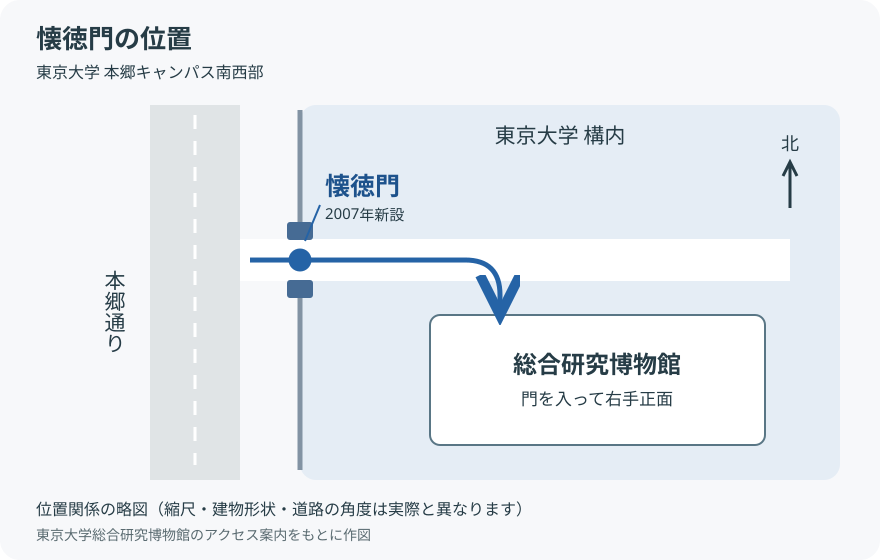

---
group:
  - 建造物
時代:
  - 平成時代
年号:
  - 2007
tags:
  - 日本史
  - 東京大学
---

# 懐徳門

**懐徳門（かいとくもん）**は、[[東京大学]]本郷キャンパスの総合研究博物館北側にある、**2007年に新設された門**。門の名称には歴史的な由来があるが、門そのものは近年設けられたものである。[東京大学総合研究博物館の解説](https://www.um.u-tokyo.ac.jp/web_museum/ouroboros/v21n3/v21n3_nishiaki.html)、[東京大学構内遺跡調査研究年報6](https://repository.dl.itc.u-tokyo.ac.jp/record/54969/files/nenpou6.pdf)

## 地図

東京大学本郷キャンパスの南西側、総合研究博物館北側に位置する。

本郷通りから門を入ると、右手正面に総合研究博物館がある。図は位置関係を示す略図で、縮尺・建物の形状・道路の角度は模式的に表している。[東京大学総合研究博物館：アクセス案内](https://www.um.u-tokyo.ac.jp/japanese/people/information/map.html)

## 名前の由来と遺構

名称は、旧前田侯爵邸を起源とする**懐徳館**に由来する。門の両脇には、旧懐徳館の煉瓦基礎などの遺構が保存・展示されている。[東京大学総合研究博物館：本郷キャンパスの史跡に関する解説](https://www.um.u-tokyo.ac.jp/web_museum/ouroboros/v16n1/v16n1_nishiaki.html)、[東京大学構内遺跡調査研究年報6](https://repository.dl.itc.u-tokyo.ac.jp/record/54969/files/nenpou6.pdf)

旧前田家邸宅の敷地は1926年の土地交換によって大学用地となった。旧館は1945年の東京大空襲で焼失し、現在の懐徳館は1951年に大学の迎賓施設として再建された。**旧邸宅・再建された懐徳館・2007年の懐徳門は、それぞれ成立時期が異なる。**[東京大学総合研究博物館：加賀殿再訪](https://umdb.um.u-tokyo.ac.jp/dkankoub/publish_db/2000Kaga/05/050100.html)、[東京大学学内広報1466号](https://www.u-tokyo.ac.jp/content/400029597.pdf)

## 「懐徳」の出典

**『論語』里仁第四・第11章の「君子懐徳（君子は徳を懐う）」**に由来する。「懐」はここでは「おもう」と読み、徳を心に留めることを意味する。

> 子曰、君子懷德、小人懷土。君子懷刑、小人懷惠。

書き下し：子曰く、君子は徳を懐い、小人は土を懐う。君子は刑を懐い、小人は恵を懐う。

大意：君子は徳や守るべき法を心に留め、小人は安住する土地や自分に与えられる利益を気にかける。[『論語』里仁第四・原文](https://ctext.org/analects/li-ren/zh)

東京大学の『学内広報』1466号も、懐徳館の「懐徳」は『論語』に由来すると説明している。したがって、**『論語』の「君子懐徳」→ 懐徳館 → 懐徳門**という命名のつながりになる。[東京大学『学内広報』1466号](https://www.u-tokyo.ac.jp/content/400029597.pdf)

## 懐徳堂との区別

江戸時代の大坂にあった学問所の[[懐徳堂]]とは別の施設。

関連：[[東京大学]]、[[日本の大学一覧の変遷（1880〜1945年）]]、[[日本の大学一覧の変遷（1945〜1985年）]]
