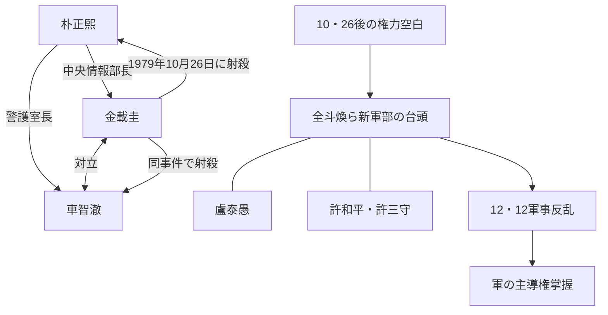

# 韓国現代史の人物相関図

既存の人物ノートを、**朴正熙政権の末期から全斗煥ら新軍部の台頭、盧泰愚の大統領就任まで**の流れで結ぶ。

## まず二つの局面を分ける

1979年10月26日の暗殺事件と、同年12月12日の軍事反乱は別の事件。前者で生じた権力空白のなか、全斗煥らが軍の主導権を握っていった。[国史編纂委員会：10・26と12・12](https://contents.history.go.kr/mobile/kc/view.do?levelId=kc_i500150)

矢印は図に記した役職・行動・時間的なつながりを表す。事件の原因すべてを示す図ではない。

## 人物を役職で整理する

| 人物 | 関係を読むための位置づけ |
| --- | --- |
| [[朴正熙]] | 維新体制の大統領。10・26事件で死亡 |
| [[金載圭]] | 中央情報部長。朴正熙・車智澈を射殺 |
| [[車智澈]] | 大統領警護室長。反体制運動への対応などをめぐり金載圭と対立 |
| 全斗煥 | 保安司令官。事件の合同捜査本部長となり、新軍部を率いる |
| [[盧泰愚]] | 全斗煥とともに軍事反乱に参加。のちの大統領 |
| [[許和平]]・[[許三守]] | 全斗煥を支えた保安司令部の側近 |
| [[許文道]] | 文民出身の政権実力者。「三許」の一人だが、軍人の二人とは経歴が違う |

側近の具体的な職歴・裁判記録は各人物ページを参照。

## 出来事の順序

| 年月日 | 出来事 | 読み分ける点 |
| --- | --- | --- |
| 1979-10-26 | 朴正熙暗殺 | 政権内部の対立と暗殺の動機を区別する |
| 1979-12-12 | 軍事反乱 | 暗殺事件の捜査と、軍指揮系統の掌握を区別する |
| 1980 | 新軍部による権力掌握が進み、全斗煥政権へ | 12・12だけで政権成立まで完結したと考えない |
| 1987 | 民主化運動を背景に6・29宣言、直接選挙 | 宣言だけでなく社会の民主化要求を見る |
| 1988 | 盧泰愚が第13代大統領に就任 | 第六共和国の開始 |

金載圭が民主主義回復を動機として主張したことと、その主張が事件の唯一の原因と確定していることは別。対立関係の図だけから動機を断定しない。

## 出典

- [国史編纂委員会：10・26と12・12](https://contents.history.go.kr/mobile/kc/view.do?levelId=kc_i500150)
- [韓国大統領記録館：第13代盧泰愚](https://www.pa.go.kr/online_contents/president/history13.jsp)
- 側近の個別情報：[[許和平]]・[[許三守]]・[[許文道]]の出典を参照。
