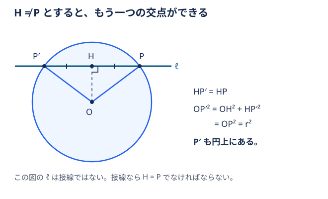

# 円の接線と半径は垂直

**円の接線は、接点に向かう半径と垂直に交わる。逆に、円上の点を通り、その点への半径に垂直な直線は、その点での接線になる。**

円とただ1点で交わる直線を接線、その共有点を接点とする。中心を $O$、半径を $r>0$、円上の点を $P$ とする。

明るい青の線が半径、濃い青の直線が接線。接点の四角い印は直角を表す。

## 接線は接点への半径に垂直

中心を $O$ とする。接点 $P$ での接線 $\ell$ に、$O$ から垂線を下ろし、その足を $H$ とする。

図は $H\ne P$ と仮定した場合の配置を表す。

もし $H\ne P$ なら、$P$ を $H$ に関して対称移動した点 $P'$ は、$\ell$ 上にあり $P'\ne P$。$HP'=HP$ なので、三平方の定理より、

$$
OP'^2=OH^2+HP'^2=OH^2+HP^2=OP^2=r^2
$$

となり、$P'$ も円上にある。共有点が2個になってしまい、接線であることに矛盾する。したがって $H=P$、すなわち $OP\perp\ell$。

## 逆：半径に垂直な直線は接線になる

$P$ を通り $OP$ に垂直な直線上の点 $Q\ne P$ については、

$$
OQ^2=OP^2+PQ^2=r^2+PQ^2>r^2
$$

なので、$P$ 以外の点は円の外にある。よって、この直線は確かに接線になる。

## 関連

- [[円の接線の方程式]]：この性質を内積で表し、接線の方程式を導く
