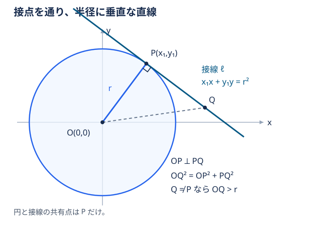

# 円の接線の方程式

円 $x^2+y^2=r^2$（$r>0$）上の点 $P(x_1,y_1)$ における接線は、

$$
\boxed{x_1x+y_1y=r^2}
$$

接点は円上にあるので、$x_1^2+y_1^2=r^2$ を満たす。以下では、円とただ1点で交わる直線を接線とし、同じ公式を3通りの方法で証明する。

## 証明1：半径と垂直であることを使う

明るい青の線が半径、濃い青の直線が接線。接点の四角い印は直角を表す。

[[円の接線と半径は垂直]]という初等幾何の性質を使う。その証明と逆の命題はリンク先にまとめる。

### 垂直条件を方程式にする

半径のベクトルは $\overrightarrow{OP}=(x_1,y_1)$。接線上の点 $Q(x,y)$ について、$\overrightarrow{OP}$ と $\overrightarrow{PQ}$ の内積が0になるので、

$$
x_1(x-x_1)+y_1(y-y_1)=0
$$

整理し、$P$ が円上にあることを使うと、

$$
x_1x+y_1y=x_1^2+y_1^2=r^2
$$

したがって、

$$
\boxed{x_1x+y_1y=r^2}
$$

$x,y$ の係数が $x_1,y_1$ になるのは、**半径のベクトルを接線の法線ベクトルにしているから**。右辺が $r^2$ になるのは、**接点を代入すると $x_1^2+y_1^2=r^2$ になるから**。

## 証明2：点と直線の距離を使う

接点 $P(x_1,y_1)$ を通る直線を、

$$
\ell:A(x-x_1)+B(y-y_1)=0
\qquad((A,B)\ne(0,0))
$$

とおく。[[点と直線の距離の公式]]より、中心 $O(0,0)$ と $\ell$ の距離は、

$$
d=\frac{|Ax_1+By_1|}{\sqrt{A^2+B^2}}
$$

接するための必要十分条件は $d=r$。実際、垂線の足を $H$ とすると、直線上の点 $Q$ が円上にある条件は、

$$
HQ^2=r^2-d^2
$$

となる。$d<r$ なら共有点は2個、$d=r$ なら $Q=H$ の1個、$d>r$ なら0個である。

一方、[[コーシー・シュワルツの不等式]]と $x_1^2+y_1^2=r^2$ より、

$$
(Ax_1+By_1)^2
\le(A^2+B^2)(x_1^2+y_1^2)
=(A^2+B^2)r^2
$$

したがって $d\le r$ であり、接するのは等号が成立するときに限る。等号成立条件は、ある実数 $\lambda\ne0$ によって、

$$
(A,B)=\lambda(x_1,y_1)
$$

と書けること。これを直線の式に代入し、$\lambda$ で割ると、

$$
x_1(x-x_1)+y_1(y-y_1)=0
$$

よって、

$$
\boxed{x_1x+y_1y=r^2}
$$

この証明では、半径との垂直を出発点にせず、**中心と直線の距離が半径に等しい条件から、係数の比を決めている**。

## 証明3：共有点の個数を使う

$P(x_1,y_1)$ を通る直線を、方向ベクトル $(u,v)\ne(0,0)$ と実数 $t$ を使って、

$$
(x,y)=(x_1+tu,\ y_1+tv)
$$

と表す。$t=0$ が接点 $P$ に対応する。

円の方程式へ代入すると、

$$
(x_1+tu)^2+(y_1+tv)^2=r^2
$$

$x_1^2+y_1^2=r^2$ を使って整理すれば、

$$
t\bigl((u^2+v^2)t+2(x_1u+y_1v)\bigr)=0
$$

$u^2+v^2>0$ なので、共有点に対応する $t$ は、

$$
t=0,\qquad
 t=-\frac{2(x_1u+y_1v)}{u^2+v^2}
$$

共有点が1個になるには、この2つの値が一致すればよく、その必要十分条件は、

$$
x_1u+y_1v=0
$$

である。このとき、直線上の任意の点について、

$$
\begin{aligned}
x_1x+y_1y
&=x_1(x_1+tu)+y_1(y_1+tv)\\
&=x_1^2+y_1^2+t(x_1u+y_1v)\\
&=r^2
\end{aligned}
$$

したがって、接線は、

$$
\boxed{x_1x+y_1y=r^2}
$$

この証明では候補の式を先に置かず、**円との連立方程式が重解を持つ条件から接線の式を導いている**。方向ベクトルで表すため、垂直な直線も含めて扱える。

## 中心が $(a,b)$ の円への拡張

円 $(x-a)^2+(y-b)^2=r^2$ 上の点 $P(x_1,y_1)$ における接線は、

$$
\boxed{(x_1-a)(x-a)+(y_1-b)(y-b)=r^2}
$$

$X=x-a,\ Y=y-b$ と座標を平行移動すれば、円は $X^2+Y^2=r^2$、接点は $(x_1-a,y_1-b)$ になる。原点中心での公式を当てはめれば得られる。

## 関連

- [[円の接線と半径は垂直]]

- [[点と直線の距離の公式]]
- [[高校数学の定理一覧]]
