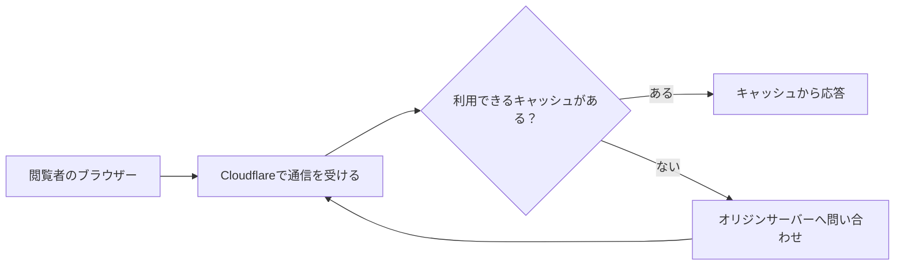

---
aliases:
  - CloudFlare
  - クラウドフレア
tags:
  - ネットワーク
  - Web
  - クラウド
確認日: 2026-11-19
---
# Cloudflare

**Webサイトを速く配信し、攻撃から守り、アプリケーションを動かすためのサービスを提供する企業・プラットフォーム。** 読み方は「クラウドフレア」。表記は **Cloudflare**。

既存のWebサイトの手前に入って通信を中継する使い方と、Cloudflare自身の基盤でサイトやプログラムを動かす使い方がある。[公式：Cloudflareの仕組み](https://developers.cloudflare.com/fundamentals/concepts/how-cloudflare-works/)、[Workers](https://developers.cloudflare.com/workers/)

## 何をしてくれる？

| 役割 | 内容 |
| --- | --- |
| DNS | ドメイン名に対応する接続先などの情報を管理する。 |
| CDN・キャッシュ | 配信拠点にコンテンツを一時保存し、元のサーバーへのアクセスや転送を減らす。 |
| セキュリティ | DDoS攻撃への対策や、WAFによるWebへの攻撃の検査などを行う。 |
| アプリの実行・公開 | WorkersやPagesで、プログラムやWebサイトを公開する。 |
| データの保存 | R2などに画像やファイルを保存する。 |

出典：[Cloudflareの仕組み](https://developers.cloudflare.com/fundamentals/concepts/how-cloudflare-works/)、[アプリの安全な配信](https://developers.cloudflare.com/reference-architecture/design-guides/secure-application-delivery/)、[Workers](https://developers.cloudflare.com/workers/)、[R2](https://developers.cloudflare.com/r2/)

## Webサイトの手前に置く仕組み

Cloudflareをプロキシとして使うと、アクセスは次のように流れる。元のサーバーは「オリジンサーバー」と呼ぶ。

Cloudflareが閲覧者に代わって元のサーバーへ接続するため、この仕組みを**リバースプロキシ**という。設定やコンテンツによってキャッシュの対象は異なり、ログイン後の画面なども含めて何でも自動的に保存するわけではない。[公式：CDNの構成](https://developers.cloudflare.com/reference-architecture/architectures/cdn/)

### DNSを使うだけの場合との違い

| DNSレコードの設定 | Webアクセスの接続先 | CDN・Web攻撃対策 |
| --- | --- | --- |
| Proxied（オレンジの雲） | Cloudflareを経由する | 対応する機能を適用できる |
| DNS only（灰色の雲） | 元のサーバーへ直接接続する | その通信はCloudflareのWebプロキシを経由しない |

**CloudflareでDNSを管理しているだけでは、Web通信が必ずCloudflare経由になるわけではない。** [公式：Proxy status](https://developers.cloudflare.com/dns/proxy-status/)

## 主なサービスの区別

| サービス | 何に使う？ |
| --- | --- |
| **Workers** | Cloudflareのネットワーク上でコードを実行する。APIやWebアプリの構築など。自分でサーバーを管理する必要を減らせる。 |
| **Pages** | Webサイトを公開する。Git連携やビルド済みファイルのアップロードに対応し、Functionsで動的処理も追加できる。 |
| **R2** | 画像・文書などの非構造化データを保存するオブジェクトストレージ。 |
| **Cloudflare Tunnel** | 自分のサーバーからCloudflareへ接続を張り、サービスにつなぐ。`cloudflared`というプログラムを使う。 |
| **1.1.1.1** | 利用者の端末から名前解決を依頼するための公開DNSリゾルバー。Webサイト運営者向けのDNS管理とは役割が違う。 |

出典：[Workers](https://developers.cloudflare.com/workers/)、[Pages](https://developers.cloudflare.com/pages/)、[R2](https://developers.cloudflare.com/r2/)、[Tunnel](https://developers.cloudflare.com/cloudflare-one/networks/connectors/cloudflare-tunnel/)、[1.1.1.1](https://developers.cloudflare.com/1.1.1.1/)

## AWSとの違い

**CloudflareはWebの配信・保護と、世界各地のネットワーク上で動かすアプリに強みがある。AWS（Amazon Web Services）は、仮想サーバー、データベース、ストレージ、分析など、システム全体を構成するための幅広い部品を提供する。** これはサービス構成から見た整理で、両者の用途には重なりがある。[Cloudflare Workers](https://developers.cloudflare.com/workers/)、[AWS製品一覧](https://aws.amazon.com/products/)

### 似た役割のサービス

| 用途 | Cloudflare | AWS |
| --- | --- | --- |
| Webコンテンツの配信・キャッシュ | CDN・Cache | Amazon CloudFront |
| ドメインのDNS管理 | Cloudflare DNS | Amazon Route 53 |
| Web攻撃・DDoS対策 | WAF・DDoS対策 | AWS WAF・AWS Shield |
| サーバーを管理せずにコードを実行 | Workers | AWS Lambda。配信拠点での処理にはLambda@Edge・CloudFront Functionsもある |
| 画像・ファイルの保存 | R2 | Amazon S3 |
| OSやソフトを選んで仮想サーバーを運用 | Workersとは異なる用途 | Amazon EC2 |

この表は役割が近いサービスの対応表。実行環境、機能、上限、料金体系まで同一ではない。たとえばR2はS3互換APIを提供するが、S3のすべての機能を実装しているわけではない。[AWSのネットワーク・配信サービス](https://docs.aws.amazon.com/whitepapers/latest/aws-overview/networking-services.html)、[Lambda](https://aws.amazon.com/lambda/)、[EC2](https://aws.amazon.com/ec2/)、[R2のS3 API互換性](https://developers.cloudflare.com/r2/api/s3/api/)

### サーバーを借りるのと、コードを動かすのは違う

EC2では、仮想サーバーを用意し、OSやソフトウェアを選んでシステムを構成できる。その分、選んだ構成に応じた管理が必要になる。Workersでは、Cloudflareが用意した実行環境へコードを配備する。サーバー管理の負担を減らせるが、その環境の仕様に合わせてアプリを作る。[EC2](https://aws.amazon.com/ec2/)、[Workers](https://developers.cloudflare.com/workers/)

AWSにもLambdaなどのサーバーレスサービスがあるため、「AWSを使うと必ず自分でサーバーを管理する」というわけではない。[Lambda](https://aws.amazon.com/lambda/)

### ブログを公開する場合

| 構成例 | 流れ |
| --- | --- |
| Cloudflareで公開 | Markdown → Astroなどでサイト生成 → WorkersやPagesで配信 |
| AWSで公開 | Markdown → サイト生成 → S3にファイルを保存 → CloudFrontでHTTPS配信 |

どちらでも静的なブログを公開できる。すでにこの保管庫で検討しているMarkdown中心の構成なら、Cloudflareの公開基盤にまとめる方法が考えられる。AWSでは、S3とCloudFrontなどを組み合わせる構成が公式に案内されている。[Workersの静的ファイル配信](https://developers.cloudflare.com/workers/)、[AWSの静的サイト構成](https://docs.aws.amazon.com/Route53/latest/DeveloperGuide/getting-started-cloudfront-overview.html)

### 料金はどちらが安い？

**用途とアクセス量による。** CloudflareにもAWSにも、製品ごとに無料枠や従量課金がある。保存量だけでなく、リクエスト数、コードの実行量、転送量、使う機能をそろえて比較する必要がある。

代表的な違いとして、R2はインターネットへのデータ転送量（エグレス）に課金しない。一方、保存量や操作回数などには課金があり、「R2全体が無料」という意味ではない。S3にも転送先や条件による無料扱いがあるので、単純に「AWSの転送はすべて有料」とは言えない。[R2料金](https://developers.cloudflare.com/r2/pricing/)、[S3料金](https://aws.amazon.com/s3/pricing/)

### 両方を組み合わせることもできる

たとえば、**閲覧者 → Cloudflareで配信・保護 → AWS上のWebサーバー**という構成にできる。Cloudflareのオリジンサーバーは、Cloudflare自身のサービスである必要はない。逆にAWSのCloudFrontも、AWS外のHTTPサーバーを配信元にできる。[Cloudflareの仕組み](https://developers.cloudflare.com/fundamentals/concepts/how-cloudflare-works/)、[CloudFrontの配信元](https://docs.aws.amazon.com/AmazonCloudFront/latest/DeveloperGuide/Introduction.html)

比較の確認日：2026年11月19日。

## この保管庫のブログ構成との関係

[[AIで書くブログのテックスタック]] と [[vaultの一部をブログにする]] では、記事をWebサイトとして公開する場所としてCloudflare Pagesが登場する。この場合、Cloudflareはサイトのファイルを置いて配信する役割も担う。

**2026年11月19日に確認した公式ドキュメントでは、新規プロジェクトにはWorkersを使うよう案内されている。** WorkersがPagesの多くの用途に対応し、アプリ構築の中心的な基盤になっているため。既存ノートの「Pagesで公開する」という構成を読むときは、この現在の案内も併せて確認する。[公式：Pagesの概要](https://developers.cloudflare.com/pages/)

関連：[[HTTPキャッシュの仕組み]]・[[AIで書くブログのテックスタック]]・[[vaultの一部をブログにする]]
