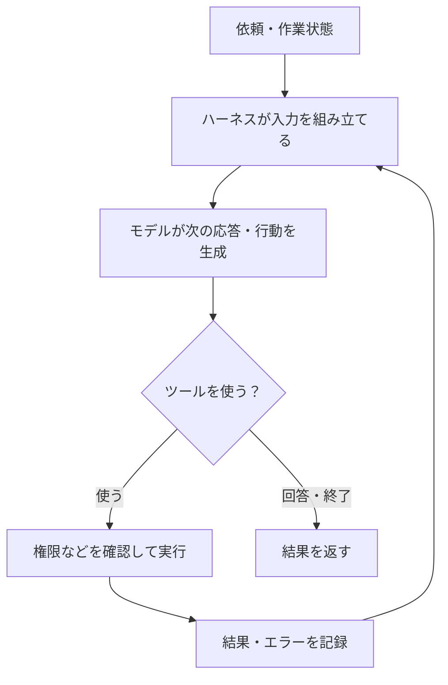

---
aliases:
  - AI のハーネス
  - エージェントハーネス
  - agent harness
  - agentic AI harness
tags:
  - AI
  - AIエージェント
確認日: 2026-11-19
---
# AIのハーネス

**AIモデルを呼び出し、ツールを実行し、その結果をモデルへ戻して、仕事を進めるための周辺ソフトウェア。** AIエージェントの文脈で使う言葉で、「モデルを動かす枠組み」「実行を取り仕切る仕組み」と考えると分かりやすい。

Anthropicは、モデルを呼び出してツール呼び出しを実行基盤へ振り分けるループをハーネスと説明している。一方、情報入力・記憶・権限制御なども含める広い使い方もあり、境界は文脈による。[Anthropic・Managed Agentsの設計](https://www.anthropic.com/research/managed-agents)、[豪州ASD・Agentic AI harnesses](https://www.cyber.gov.au/sites/default/files/2026-10/Agentic%20AI%20harnesses%20%28September%202026%29.pdf)

## モデルとハーネスの違い

| 要素 | 役割 |
| --- | --- |
| モデル | 入力を読み、次の応答や行動を生成する。 |
| ハーネス | 必要な入力を渡し、ツールの実行・結果の返却・反復・終了などを取り仕切る。 |
| ツール | ファイル検索、コマンド実行、Web検索などの具体的な操作を担う。 |
| サンドボックス | コードやコマンドを実行する環境と、その隔離・制限。 |
| エージェント | モデルとこれらの仕組みを組み合わせ、目標に向けて行動するシステム。 |

同じモデルでも、使えるツール、渡される情報、作業の続け方が違えば、仕事の結果は変わる。モデルの性能と、エージェント全体の性能は分けて見る必要がある。[Anthropic・長時間動くエージェントのハーネス](https://www.anthropic.com/research/effective-harnesses-for-long-running-agents)

## 基本的な動き

実装によっては、途中に承認待ち、再試行、予算上限、引き継ぎなどが入る。この図は一般化した模式図。

## ハーネスが担当すること

| 機能 | 具体例 |
| --- | --- |
| 情報の組み立て | 指示、会話履歴、検索結果、作業中のファイルをモデルに渡す。 |
| ツールとの接続 | モデルが要求した検索や編集を、実際の操作へ変換する。 |
| 権限の管理 | 読める場所・書ける場所・実行できる操作を制御する。 |
| 状態の維持 | 進捗、変更内容、未完了の作業を保存し、次の処理へ引き継ぐ。 |
| 実行の管理 | エラー処理、反復、停止条件、使用量の上限を管理する。 |
| 記録と評価 | 何を実行し、どういう結果になったかを残す。 |

これらすべてが、常に一つのプログラムに入っているとは限らない。[ASD・ハーネスの構成要素](https://www.cyber.gov.au/sites/default/files/2026-10/Agentic%20AI%20harnesses%20%28September%202026%29.pdf)

## この保管庫での作業に当てはめると

「トピックのページを探し、なければ作り、回答をページに書く」という方針自体は指示。その指示をモデルへ渡し、検索・ファイル編集・Git操作のツールを呼び出せるようにし、操作結果を返す仕組みがハーネスに相当する。

たとえば、モデルが「コミットする」という操作を生成しても、それだけでGitは動かない。実行側がコマンドを受け取り、権限を確認し、Gitを実行して結果を返す必要がある。これは役割を説明するための例で、特定アプリの内部実装を示すものではない。

## プロンプトやスキルとの違い

**プロンプトやスキルは、仕事の進め方を伝える内容。ハーネスは、その内容を渡して実際の処理を動かす仕組み。** 指示ファイルだけでツール実行や権限制御が実装されるわけではない。

長い作業では、会話の要約に加え、進捗ファイル・機能一覧・Git履歴・テスト結果などを残す設計が役立つ。Anthropicの実験では、初回に環境を準備し、後続の処理で小さく実装・検証して引き継ぐ方法を採った。これはハーネス設計の一例で、唯一の方式ではない。[Anthropic・長時間作業の実験](https://www.anthropic.com/research/effective-harnesses-for-long-running-agents)

## 「評価ハーネス」という別の使い方

AI分野では、テスト問題をモデルに渡し、回答を採点・集計する実験の枠組みも「評価ハーネス」と呼ぶ。作業を進めるエージェントハーネスと、性能を測る評価ハーネスでは目的が異なるため、何を実行する枠組みかを確認する。

確認日：2026年11月19日。
