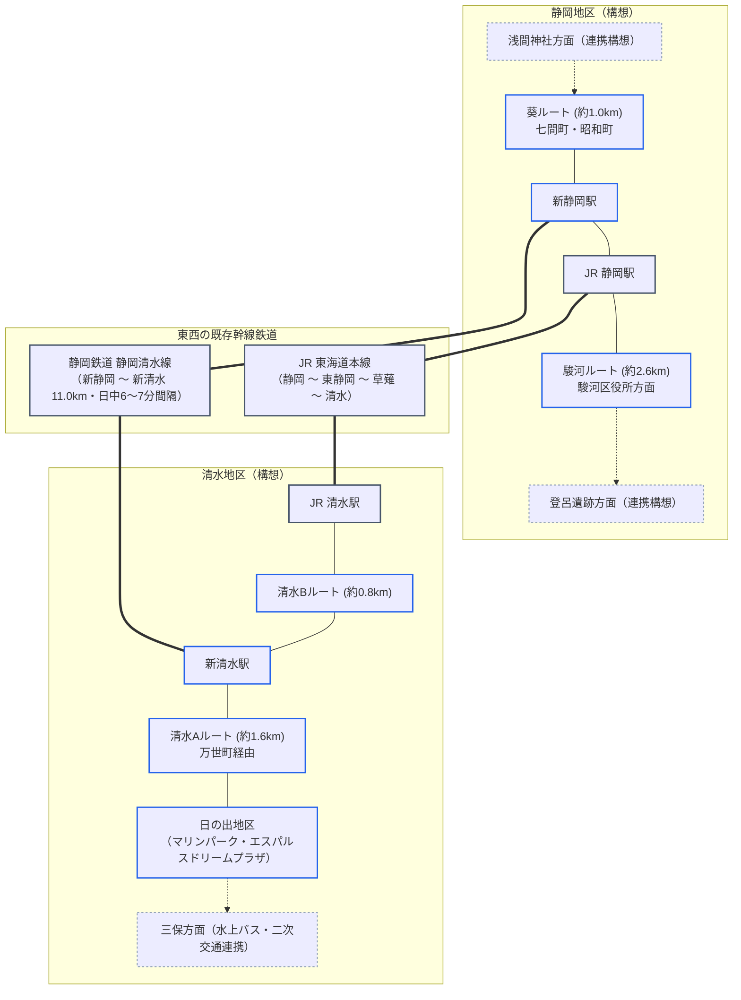

# 静岡市のLRT

**静岡市におけるLRT（次世代型路面電車システム）の導入構想は、2010年代前半に活発に検討されたものの、既存の鉄道網（静岡鉄道）の存在や道路空間・採算性の課題から事業化に至らず、現在は事実上の停滞・凍結状態にある。** 近年は、LRT単体の大規模新設ではなく、既存鉄道やバスネットワークの機能強化、清水臨海部等における自走式ロープウェイや自動運転など「新モビリティ」の導入検討へと現実的な方針転換が進んでいる。

## 歴史的背景：かつての路面電車
静岡市にはかつて、静岡鉄道（静鉄）が運行していた路面電車が存在していた。

| 路線名 | 運行区間 | 開業 | 廃止 | 主な廃止理由 |
| --- | --- | --- | --- | --- |
| **静岡市内線** | 静岡駅前 〜 安西 | 1922年 | 1962年 | モータリゼーションの進展に伴う道路渋滞と乗客減少 |
| **清水市内線** | 港橋 〜 清水駅前 〜 三保 | 1928年 | 1975年 | 1974年の七夕豪雨による被災（巴川氾濫）からの復旧断念 |

これらが廃止された後、静岡市内は自家用車およびバスを中心とした道路交通へと移行したが、2000年代以降の少子高齢化、環境負荷低減、コンパクトシティ構想の広まりとともに、欧州などで普及したLRTの導入を求める声が高まった。

## 構想ルートと路線図

2011年の「静岡市LRT導入研究会」では、中心市街地の回遊性向上と東西アクセスの強化を目的に、**静岡地区2ルート**、**清水地区2ルート**の計4ルート（総延長約6.0km）が具体的な想定ルートとして検討された。

### 路線図（検討ルートと既存鉄道網）

<svg viewBox="0 0 940 480" width="940" role="img" aria-label="静岡市LRT構想の想定ルート図" xmlns="http://www.w3.org/2000/svg" style="max-width:100%;height:auto;background:transparent;">
  <!-- 外枠 -->
  <rect x="5" y="5" width="930" height="470" rx="8" fill="none" stroke="currentColor" stroke-opacity="0.2" stroke-width="1"/>

  <!-- 凡例 -->
  <g transform="translate(30, 32)">
    <text x="0" y="0" fill="currentColor" font-size="14" font-weight="bold">【凡例】</text>
    <line x1="60" y1="-4" x2="95" y2="-4" stroke="#2563eb" stroke-width="5" stroke-linecap="round"/>
    <text x="105" y="0" fill="currentColor" font-size="12">LRT想定ルート（2011年検討）</text>

    <line x1="310" y1="-4" x2="345" y2="-4" stroke="#1e3a8a" stroke-width="4" stroke-linecap="round"/>
    <text x="355" y="0" fill="currentColor" font-size="12">静岡鉄道 静岡清水線（既存）</text>

    <line x1="565" y1="-4" x2="600" y2="-4" stroke="#475569" stroke-width="4" stroke-linecap="round"/>
    <text x="610" y="0" fill="currentColor" font-size="12">JR東海道本線（既存）</text>

    <line x1="775" y1="-4" x2="810" y2="-4" stroke="currentColor" stroke-width="2" stroke-dasharray="4,4" opacity="0.6"/>
    <text x="820" y="0" fill="currentColor" font-size="12" opacity="0.8">連携構想</text>
  </g>

  <!-- エリア枠 -->
  <rect x="25" y="55" width="245" height="405" rx="6" fill="currentColor" fill-opacity="0.03" stroke="currentColor" stroke-opacity="0.15"/>
  <text x="40" y="80" fill="currentColor" font-size="13" font-weight="bold">静岡都心エリア</text>

  <rect x="670" y="55" width="245" height="405" rx="6" fill="currentColor" fill-opacity="0.03" stroke="currentColor" stroke-opacity="0.15"/>
  <text x="685" y="80" fill="currentColor" font-size="13" font-weight="bold">清水臨海エリア</text>

  <!-- 既存幹線 -->
  <!-- 静鉄線（水平線 Y=190） -->
  <path d="M 210 190 L 710 190" stroke="#1e3a8a" stroke-width="4" fill="none"/>
  <text x="460" y="168" fill="currentColor" font-size="13" font-weight="bold" text-anchor="middle" paint-order="stroke" stroke="var(--background-primary, #1e1e1e)" stroke-width="4" stroke-linejoin="round">静岡鉄道 静岡清水線（約11km / 日中6〜7分間隔）</text>
  <text x="460" y="148" fill="currentColor" font-size="11" opacity="0.75" text-anchor="middle" paint-order="stroke" stroke="var(--background-primary, #1e1e1e)" stroke-width="4" stroke-linejoin="round">（新静岡 〜 長沼 〜 草薙 〜 狐ヶ崎 〜 新清水）</text>

  <!-- JR線（Y=290を直進後、X=560から上方へカーブしてJR清水駅(710, 110)へ） -->
  <path d="M 210 290 L 560 290 C 620 290, 660 180, 710 110" stroke="#475569" stroke-width="4" fill="none"/>
  <text x="430" y="315" fill="currentColor" font-size="13" font-weight="bold" text-anchor="middle" paint-order="stroke" stroke="var(--background-primary, #1e1e1e)" stroke-width="4" stroke-linejoin="round">JR東海道本線（東静岡・草薙 経由）</text>
  <text x="430" y="333" fill="currentColor" font-size="11" opacity="0.75" text-anchor="middle" paint-order="stroke" stroke="var(--background-primary, #1e1e1e)" stroke-width="4" stroke-linejoin="round">（静岡 〜 東静岡 〜 草薙 〜 清水）</text>

  <!-- 静岡側 LRTルート -->
  <!-- 浅間神社方面への延伸構想 -->
  <line x1="85" y1="100" x2="85" y2="135" stroke="currentColor" stroke-width="2" stroke-dasharray="4,4" opacity="0.6"/>
  <!-- 葵ルート：七間町 (85, 135) -> 昭和町 (140, 155) -> 新静岡 (210, 190) -->
  <path d="M 85 135 L 140 155 L 210 190" stroke="#2563eb" stroke-width="5" fill="none" stroke-linejoin="round" stroke-linecap="round"/>
  
  <!-- 駿河ルート：新静岡 (210, 190) -> 静岡駅 (210, 290) -> 駿河区役所 (210, 370) -->
  <path d="M 210 190 L 210 370" stroke="#2563eb" stroke-width="5" fill="none" stroke-linejoin="round" stroke-linecap="round"/>
  <!-- 登呂遺跡方面への延伸構想 -->
  <line x1="210" y1="370" x2="210" y2="425" stroke="currentColor" stroke-width="2" stroke-dasharray="4,4" opacity="0.6"/>

  <!-- 清水側 LRTルート -->
  <!-- 清水Bルート：JR清水 (710, 110) -> 新清水 (710, 190) -->
  <path d="M 710 110 L 710 190" stroke="#2563eb" stroke-width="5" fill="none" stroke-linejoin="round" stroke-linecap="round"/>
  <!-- 清水Aルート：新清水 (710, 190) -> 万世町 (745, 255) -> 日の出 (770, 330) -->
  <path d="M 710 190 L 745 255 L 770 330" stroke="#2563eb" stroke-width="5" fill="none" stroke-linejoin="round" stroke-linecap="round"/>
  <!-- 三保方面への二次交通・水上バス構想 -->
  <line x1="770" y1="330" x2="770" y2="425" stroke="currentColor" stroke-width="2" stroke-dasharray="4,4" opacity="0.6"/>

  <!-- 静岡地区 駅・停留場ラベル -->
  <!-- 浅間神社 -->
  <circle cx="85" cy="100" r="4" fill="none" stroke="currentColor" stroke-width="1.5" opacity="0.7"/>
  <text x="85" y="85" fill="currentColor" font-size="11" text-anchor="middle" opacity="0.8">浅間神社方面</text>

  <!-- 七間町 -->
  <circle cx="85" cy="135" r="5" fill="white" stroke="#2563eb" stroke-width="2"/>
  <text x="73" y="140" fill="currentColor" font-size="11" text-anchor="end" paint-order="stroke" stroke="var(--background-primary, #1e1e1e)" stroke-width="3" stroke-linejoin="round">七間町</text>

  <!-- 昭和町 -->
  <circle cx="140" cy="155" r="5" fill="white" stroke="#2563eb" stroke-width="2"/>
  <text x="140" y="138" fill="currentColor" font-size="11" text-anchor="middle" paint-order="stroke" stroke="var(--background-primary, #1e1e1e)" stroke-width="3" stroke-linejoin="round">昭和町</text>
  <text x="45" y="175" fill="#2563eb" font-size="11" font-weight="bold" text-anchor="start" paint-order="stroke" stroke="var(--background-primary, #1e1e1e)" stroke-width="3" stroke-linejoin="round">【葵ルート】約1.0km</text>

  <!-- 新静岡駅 -->
  <circle cx="210" cy="190" r="8" fill="white" stroke="#1e3a8a" stroke-width="3"/>
  <circle cx="210" cy="190" r="4" fill="#2563eb"/>
  <text x="225" y="195" fill="currentColor" font-size="13" font-weight="bold" paint-order="stroke" stroke="var(--background-primary, #1e1e1e)" stroke-width="4" stroke-linejoin="round">新静岡駅</text>

  <!-- 静岡駅 -->
  <circle cx="210" cy="290" r="8" fill="white" stroke="#475569" stroke-width="3"/>
  <circle cx="210" cy="290" r="4" fill="#2563eb"/>
  <text x="225" y="295" fill="currentColor" font-size="13" font-weight="bold" paint-order="stroke" stroke="var(--background-primary, #1e1e1e)" stroke-width="4" stroke-linejoin="round">JR 静岡駅</text>

  <!-- 駿河区役所 -->
  <circle cx="210" cy="370" r="5" fill="white" stroke="#2563eb" stroke-width="2"/>
  <text x="225" y="375" fill="currentColor" font-size="11" paint-order="stroke" stroke="var(--background-primary, #1e1e1e)" stroke-width="3" stroke-linejoin="round">駿河区役所方面</text>
  <text x="195" y="335" fill="#2563eb" font-size="11" font-weight="bold" text-anchor="end" paint-order="stroke" stroke="var(--background-primary, #1e1e1e)" stroke-width="3" stroke-linejoin="round">【駿河ルート】約2.6km</text>

  <!-- 登呂遺跡 -->
  <circle cx="210" cy="425" r="4" fill="none" stroke="currentColor" stroke-width="1.5" opacity="0.7"/>
  <text x="210" y="445" fill="currentColor" font-size="11" text-anchor="middle" opacity="0.8">登呂遺跡方面</text>

  <!-- 清水地区 駅・停留場ラベル -->
  <!-- JR清水駅 -->
  <circle cx="710" cy="110" r="8" fill="white" stroke="#475569" stroke-width="3"/>
  <circle cx="710" cy="110" r="4" fill="#2563eb"/>
  <text x="725" y="115" fill="currentColor" font-size="13" font-weight="bold" paint-order="stroke" stroke="var(--background-primary, #1e1e1e)" stroke-width="4" stroke-linejoin="round">JR 清水駅</text>
  <text x="725" y="152" fill="#2563eb" font-size="11" font-weight="bold" text-anchor="start" paint-order="stroke" stroke="var(--background-primary, #1e1e1e)" stroke-width="3" stroke-linejoin="round">【清水Bルート】約0.8km</text>

  <!-- 新清水駅 -->
  <circle cx="710" cy="190" r="8" fill="white" stroke="#1e3a8a" stroke-width="3"/>
  <circle cx="710" cy="190" r="4" fill="#2563eb"/>
  <text x="725" y="195" fill="currentColor" font-size="13" font-weight="bold" paint-order="stroke" stroke="var(--background-primary, #1e1e1e)" stroke-width="4" stroke-linejoin="round">新清水駅</text>

  <!-- 万世町 -->
  <circle cx="745" cy="255" r="5" fill="white" stroke="#2563eb" stroke-width="2"/>
  <text x="733" y="255" fill="currentColor" font-size="11" text-anchor="end" paint-order="stroke" stroke="var(--background-primary, #1e1e1e)" stroke-width="3" stroke-linejoin="round">万世町</text>
  <text x="785" y="285" fill="#2563eb" font-size="11" font-weight="bold" text-anchor="start" paint-order="stroke" stroke="var(--background-primary, #1e1e1e)" stroke-width="3" stroke-linejoin="round">【清水Aルート】約1.6km</text>

  <!-- 日の出地区 -->
  <circle cx="770" cy="330" r="6" fill="white" stroke="#2563eb" stroke-width="2.5"/>
  <text x="755" y="328" fill="currentColor" font-size="12" font-weight="bold" text-anchor="end" paint-order="stroke" stroke="var(--background-primary, #1e1e1e)" stroke-width="4" stroke-linejoin="round">日の出地区</text>
  <text x="755" y="346" fill="currentColor" font-size="10" opacity="0.8" text-anchor="end" paint-order="stroke" stroke="var(--background-primary, #1e1e1e)" stroke-width="3" stroke-linejoin="round">（マリンパーク・ドリプラ）</text>

  <!-- 三保 -->
  <circle cx="770" cy="425" r="4" fill="none" stroke="currentColor" stroke-width="1.5" opacity="0.7"/>
  <text x="770" y="445" fill="currentColor" font-size="11" text-anchor="middle" opacity="0.8">三保方面（水上バス等）</text>
</svg>

### 検討された各ルートの詳細

| エリア | ルート名 | 区間 | 距離 | 主な役割・狙い |
| --- | --- | --- | --- | --- |
| **静岡地区** | **葵ルート**（Aルート） | 新静岡駅 〜 昭和町 〜 七間町 | 約1.0 km | 呉服町・七間町など中心商店街の回遊性向上。将来的には浅間神社方面や駿府城公園周辺への波及を視野。 |
| **静岡地区** | **駿河ルート**（Bルート） | 新静岡駅 〜 JR静岡駅 〜 駿河区役所方面 | 約2.6 km | 静岡駅南口の活性化と行政拠点（駿河区役所）へのアクセス確保。南部・登呂方面への二次交通結節。 |
| **清水地区** | **清水Aルート** | 新清水駅 〜 万世町 〜 日の出地区 | 約1.6 km | 清水港ベイエリア（マリンパーク、エスパルスドリームプラザ）への観光客・買い物客の誘導。 |
| **清水地区** | **清水Bルート** | 新清水駅 〜 JR清水駅 | 約0.8 km | JRと静鉄の間（約800mの徒歩区間）をつなぐ結節短絡線。 |

## なぜ実現しなかったのか（主な課題）

1. **静岡鉄道 静岡清水線（静鉄電車）がすでに存在すること**
   * 新静岡〜新清水間（約11km）を日中6〜7分間隔の高頻度運転で結んでおり、都市間を結ぶ軌道系交通として極めて高い機能・定時性をすでに発揮している。
   * 東西方向の幹線は静鉄電車とJR東海道線でカバーされているため、LRTを新設する場合は南北軸や市街地局所ルートに限られ、需要規模が小さくなりやすい。
2. **道路空間（幅員）の制約と自動車渋滞への懸念**
   * 静岡市中心部の主要道路（国道1号など）は交通量が多く、LRT用軌道を敷設するために車線を削減することに対する警察や道路管理者、地域住民・ドライバーからの懸念が根強かった。
3. **多額の初期投資と採算性**
   * 軌道敷設・車両導入・給電設備などに数百億円規模の整備費が必要となる。
   * 人口規模や車社会の実態から十分な採算性・投資回収が見込めず、運行主体（民間事業者）の引き受け手や市の財政負担の大きさがボトルネックとなった。

## 現在の状況と方向性
2023年8月に栃木県で「宇都宮ライトレール」が開業し成功を収めたことで、地方都市のLRTが再び全国的な関心を集めた。しかし、静岡市ではLRT新設を再開させる動きにはなっておらず、難波喬司市長のもとでより現実的・複合的な都市・交通政策が進められている。

* **JRと静鉄の結節点強化**
  * 東静岡駅北口の新アリーナ建設構想に伴い、JR東静岡駅と静鉄・長沼駅を結ぶペデストリアンデッキの整備や長沼駅の移設・改良など、既存駅周辺の回遊性向上が推進されている。
* **清水ウォーターフロントにおける新交通システム検討**
  * 清水駅〜マリンパーク・三保エリアなどの周遊交通として、多額の地上レール敷設を伴うLRTではなく、**自走式ロープウェイ（Zippar等）**、小型グリーンスローモビリティ、自動運転小型バスなどの低コストで導入しやすい次世代モビリティの検討・実証が進められている。
* **バス交通再編とMaaSの推進**
  * しずてつジャストラインを基軸とした路線バス網の再編、キャッシュレス決済や乗り継ぎ割引の拡充、オンデマンド交通やMaaSアプリとの連携によるラストワンマイルの利便性向上に軸足が置かれている。
